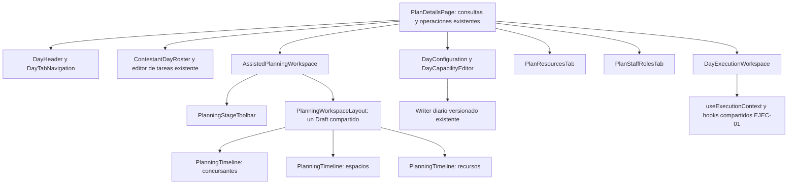
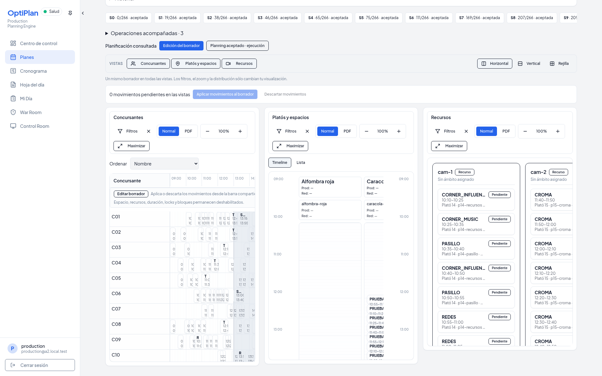
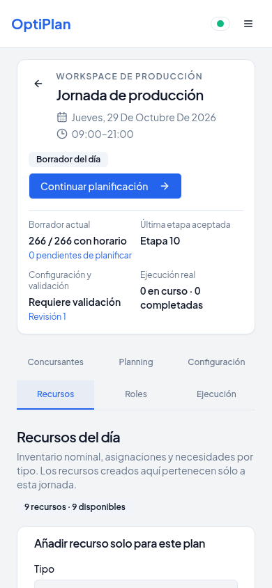
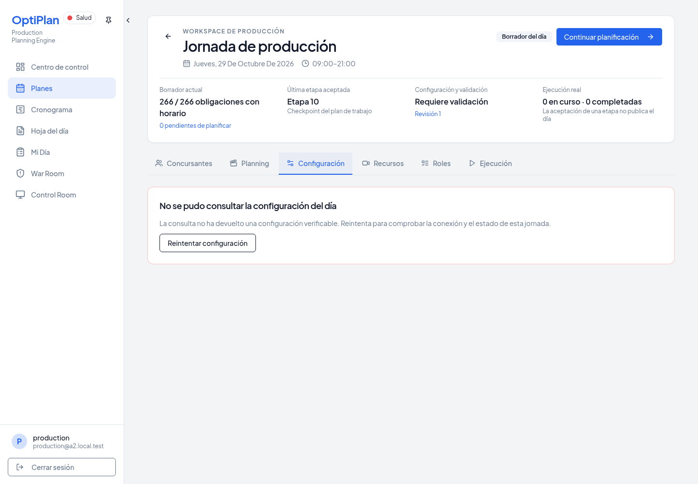
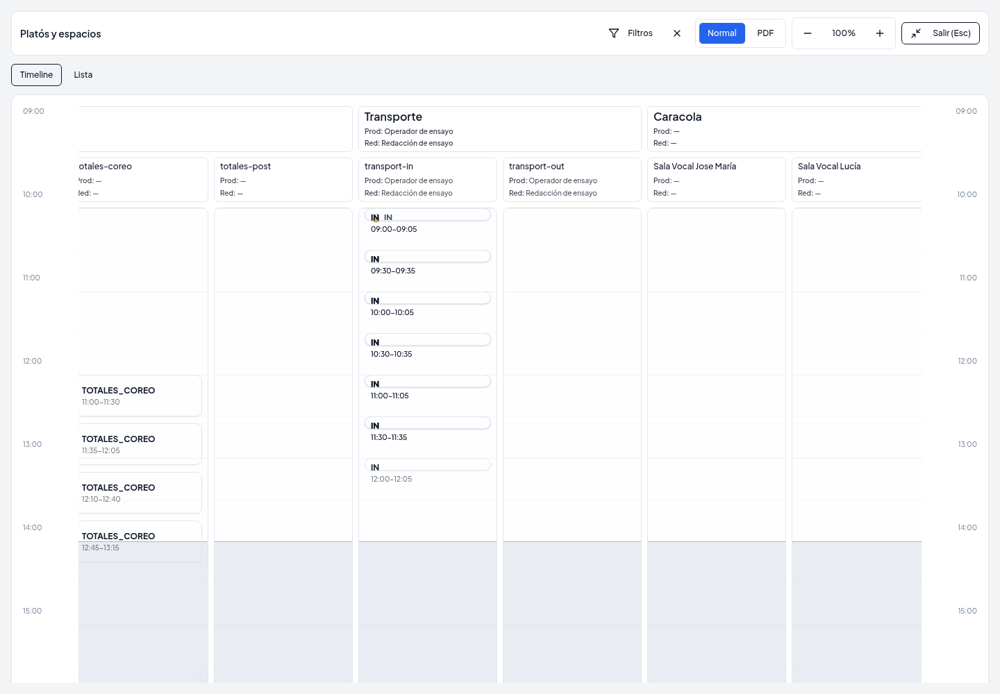

# Day Workspace — Evidence y revisión

Estado: PR [#1126](https://github.com/angelvicen92/production-planner/pull/1126)
en borrador. No se ha hecho merge.

Base inicial solicitada: `c7f85411ac13b62f4be34de09061124f7460b7e0`.
Durante el trabajo se integró EJEC-01 (#1124). Se incorporó `main` en
`cdbf3570c1f55acd6a5d6c3dc196f48458e67866` y se resolvieron los solapamientos
de la página, el timeline y el arnés conservando su autoridad de ejecución.
Este PR no cambia el backend, la migración 093 ni los permisos de EJEC-01.

## Problema y resultado

La página anterior tenía 7.290 líneas, controles V3/V4 en la cabecera y una
selección ordinaria de generaciones del planificador. Preparación, diagnóstico,
planificación y seguimiento compartían el mismo nivel visual.

La página queda en 4.547 líneas. Conserva el editor de tareas existente y las
operaciones históricas, y delega navegación, resumen, concursantes, configuración,
recursos, responsables y ejecución en componentes con responsabilidad concreta.
Hay exactamente seis pestañas con URL: Concursantes, Planning, Configuración,
Recursos, Roles y Ejecución. Se conservan los demás parámetros de la URL.

La cabecera muestra la fecha y horario reales, cobertura del Draft, última etapa,
revisión, vigencia de validación y ejecución. No equipara aceptar una etapa con
publicar la jornada. El contrato de Plan no tiene nombre editable: el título
alternativo es «Jornada de producción», acompañado de la fecha.

## Componentes y autoridad

Los paneles comparten tareas, preview y movimientos locales. No crean sesiones,
propuestas, validaciones ni motores por vista. Los cambios visuales se guardan
por usuario/día/vista en almacenamiento local; no se guardan como configuración
operativa. El último panel no puede ocultarse. Las vistas ya abiertas conservan
su montaje al navegar entre pestañas o al ocultarlas.

El modo Draft permite el ajuste temporal que admite el servicio existente.
El modo Planning aceptado permite acciones de ejecución según autoridad y no
permite arrastrar. Los datos done/in_progress conservan la protección existente.
La tabla consulta el contexto productivo por tarea, envía `expectedStatus` mediante
el hook compartido y usa `executionDuration`, `executionClockCurrent` y el reloj
del servidor. Auxiliar y Viewer no reciben permisos por inferencia de la UI.

## Flujo ordinario y mantenimiento

Assisted es el flujo principal. Scope, propuesta, aplicación al Draft, validación
y aceptación conservan sus endpoints y guards. Autopilot mantiene sus condiciones
y la confirmación original. Los ajustes de bloques y movimientos quedan en
herramientas secundarias; el historial carga sus tiempos al abrirse.

Los controles Legacy/V3/V4 y sus diagnósticos se conservan bajo mantenimiento
avanzado de Administración. Las rutas del servidor siguen intactas. La consulta
V4 no se activa al abrir una jornada ordinaria.

## Operaciones y límites por pestaña

| Pestaña | Operaciones conectadas a contratos existentes | Límite relevante |
| --- | --- | --- |
| Concursantes | Alta, ficha, canción, instrumento, coach, disponibilidad, notas, tareas y retirada protegida; obligaciones sin concursante visibles aparte | El contrato no permite renombrar un concursante creado. La UI lo explica sin inventar un writer. |
| Planning | Siete combinaciones no vacías, tres layouts, filtros independientes, orden por nombre/llegada/primera/última/plantilla real, zoom, densidad, fullscreen/Esc; Draft y aceptado | El ajuste manual mueve tareas con horario; no coloca obligaciones aún sin planificar. |
| Configuración | Horario, comida/modo, transición, preferencia AUTO/SOFT y reparto, campos existentes del optimizador; restore/refresh y procedencia | Las capacidades parciales siguen en diagnóstico. No se crean capacidades que no tenga el contrato. |
| Recursos | Catálogo de tipos de consulta, creación diaria, disponibilidad, asignación a zona/espacio, unión nominal efectiva, requisitos separados y enlace a agenda | La disponibilidad del inventario se representa según el booleano del contrato. No se inventan turnos de disponibilidad nominal. |
| Roles | Selección de personal existente, Producción/Redacción, zone/space, Reality e itinerantes existentes, guardar y recargar | Asignar responsables no concede permisos. La preparación verifica zone y la ejecución verifica autoridad space, guardado zone y lectura efectiva en cabeceras. Reality/itinerantes conservan sus contratos; no se han vuelto a certificar por UI en este PR. |
| Ejecución | Contadores reales, búsqueda, filtros combinables, diez ordenaciones, columnas, acciones según autoridad, reset confirmado | Requiere contexto verificable, conexión y estado permitido por EJEC-01; el servidor resuelve carreras y conflictos. |

La consulta efectiva fallida ya no se convierte silenciosamente en defaults:
los errores de procedencia se propagan y el HTTP devuelve JSON 500 saneado.
La pantalla muestra un mensaje operativo, ofrece reintento y restringe detalles
técnicos a Administración. Éste es el único ajuste de servidor del PR.

## Validación y capturas

Una ejecución interrumpida o agotada no se cuenta como PASS. El recorrido
[ui-replay/integration.json](DAY-WORKSPACE-PREMIUM/ui-replay/integration.json)
pasa sobre el snapshot histórico S0–S10, con 266 obligaciones. No se presenta
esa reapertura como generación fresca de once etapas.

| Comprobación | Resultado registrado |
| --- | --- |
| `npm run check` | PASS |
| TypeScript del arnés | PASS |
| `npm run build` | PASS; conserva aviso de bundle >500 kB y datos Browserslist antiguos |
| Tests focales y de producto | 120/120; incluye permisos, configuración, workflow Assisted y EJEC-01 |
| Checksums oficiales | 10/10 PASS |
| Reapertura multivista real | PASS; siete combinaciones, 266 tareas, Draft/Stage/material SQL intactos |
| Filtro independiente y arrastre local compartido | PASS; movimiento visible en otras representaciones, conservado tras tick y descartado sin write |
| Fallo HTTP efectivo y reintento | PASS; columna renombrada sólo en DB desechable, HTTP 500 real, restauración y recuperación |
| Writer diario | PASS; horario por UI, recarga y restore versionado; snapshot aceptado intacto |
| Ejecución global UI y responsables | PASS; [ejecución](DAY-WORKSPACE-PREMIUM/execution/integration.json), incluidas Interrumpir/Reanudar, reset autorizado y cabeceras tras guardar Roles |
| CI | [Checks del PR](https://github.com/angelvicen92/production-planner/pull/1126/checks); los resultados por head no se extrapolan a commits posteriores |

Preparación verificada con Chromium y PostgreSQL/Auth/HTTP desechables:

- crear concursante, editar canción, recargar y retirar; concursantes originales intactos;
- crear recurso del día sin fila en el catálogo general;
- asignar a plató, recargar y comprobar herencia efectiva;
- asignar la misma identidad directamente al espacio y conservar la unión;
- seleccionar Producción y Redacción del catálogo, guardar y recargar;
- seis pestañas a 390 px sin desbordamiento del viewport;
- capturas de escritorio, móvil y oscuro inspeccionadas.

Capturas reales del snapshot aceptado:

[Fullscreen](DAY-WORKSPACE-PREMIUM/ui-replay/workspace-fullscreen.png),
[configuración](DAY-WORKSPACE-PREMIUM/ui-replay/workspace-configuration-desktop.png),
[ejecución](DAY-WORKSPACE-PREMIUM/ui-replay/workspace-execution-desktop.png)
y las demás combinaciones y pestañas están en la misma carpeta. El JSON enumera
las operaciones y capturas sin incluir logs privados ni credenciales.

Las personas QA sólo se crean como fixture SQL del entorno desechable; no hay
writer de catálogo general nuevo en la aplicación.

La reapertura del snapshot histórico aceptado es una comprobación de UI, no
una ejecución nueva del solver. La prueba fresca S0→S11 exige por separado
266/266, cero regresiones HARD/REQUIRED y el audit canónico existente. No se
han relajado sus asserts, su búsqueda ni sus presupuestos.

## Rendimiento

Se retiró la hoja remota bloqueante que solicitaba más de veinte familias y
la importación duplicada de fuentes. Se conservan Plus Jakarta Sans y JetBrains
Mono como fuentes locales variables (78.380 y 90.680 bytes, con licencias OFL).
El navegador ya no depende de esa petición externa para completar la carga.

Los paneles se montan al visitarse por primera vez. Una preferencia visual no
refresca datos ni solicita un run. Los movimientos locales no se descartan por
el tick del reloj. El arnés mide la interacción de las siete combinaciones;
estos tiempos incluyen automatización y no son un benchmark de frames.

La instrumentación durante el desarrollo registra medianas de 6.842 ms antes
y 1.621 ms después de aislar los ticks. Son tiempos de secuencias automatizadas,
con concurrencia diferente al arrancar; no permiten atribuir una mejora
porcentual controlada. Se conservan medidas y límites en
[performance.json](DAY-WORKSPACE-PREMIUM/performance.json).

La referencia de búsqueda #1123 es AUTO 55.625 branches y SOFT 4/2+2 42.276.
Un intento local AUTO alcanzó el límite productivo de 300 s con 46.403 branches,
cuando otra suite competía por CPU (cuota local: dos CPU). No demuestra una
regresión del solver ni certifica el gate. El resultado se registra como
agotamiento, conservando límites y decisiones. No existe una medición homogénea
de render anterior/posterior que permita afirmar una mejora porcentual de UI.

## Validaciones pendientes y riesgo residual

- Cerrar las pruebas frescas A2 y CI sobre el head entregado.
- La conexión Realtime/WebSocket real y el despliegue publicado quedan fuera del entorno desechable.
- No se escribe en Supabase real ni se publica en Replit. No hay merge.

## Demo de cinco minutos

| Tiempo | Acción y evidencia que debe explicar Producción |
| --- | --- |
| 0:00–0:40 | Abrir jornada: fecha, horario, cobertura, etapa aceptada y ejecución. Distinguir el Draft y la aceptación de una publicación. |
| 0:40–1:20 | Revisar concursantes y obligaciones sin concursante; abrir ficha y mostrar datos realmente editables. |
| 1:20–2:40 | Entrar en Planning, seleccionar scope, mostrar propuesta/Draft/validación/aceptación. Activar concursantes + espacios + recursos, cambiar distribución y maximizar una vista. |
| 2:40–3:25 | Configuración: horario efectivo, procedencia y revisión. Mostrar que guardar requiere revalidar; restaurar herencia con confirmación. |
| 3:25–4:10 | Recursos: identidad diaria y herencia. Roles: Producción y Redacción del plató/espacio, sin confundir responsabilidad y permiso. |
| 4:10–5:00 | Planning aceptado sin arrastre; Ejecución con filtros y acciones autorizadas. Mostrar confirmación del servidor, reset separado y consulta de Viewer. |

No presentar una operación pendiente de certificación como si hubiera pasado.
