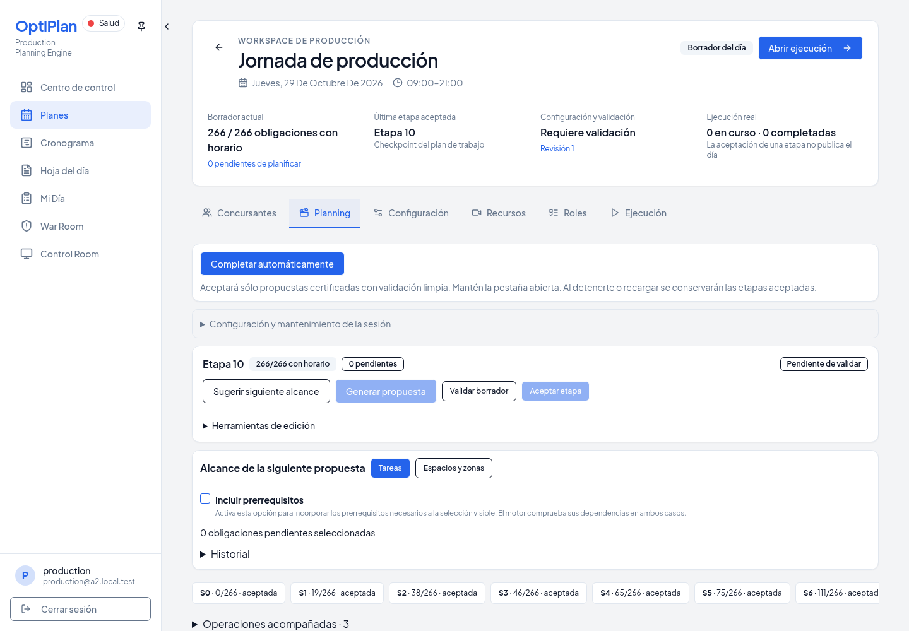
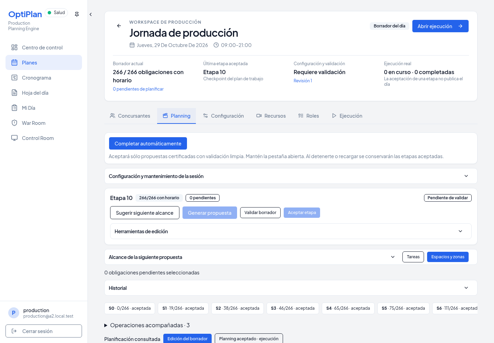
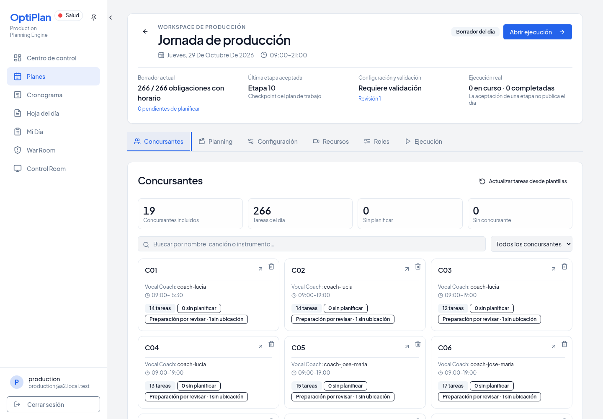
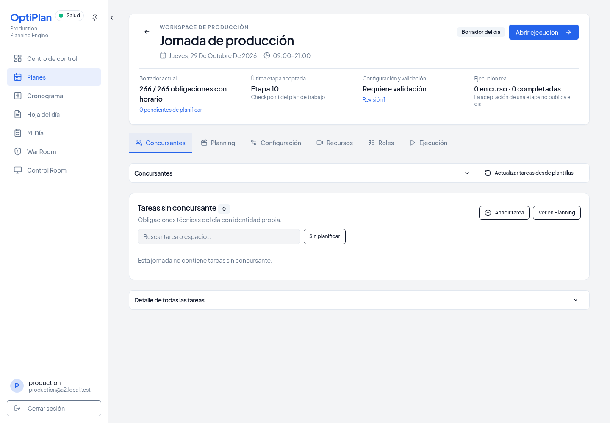
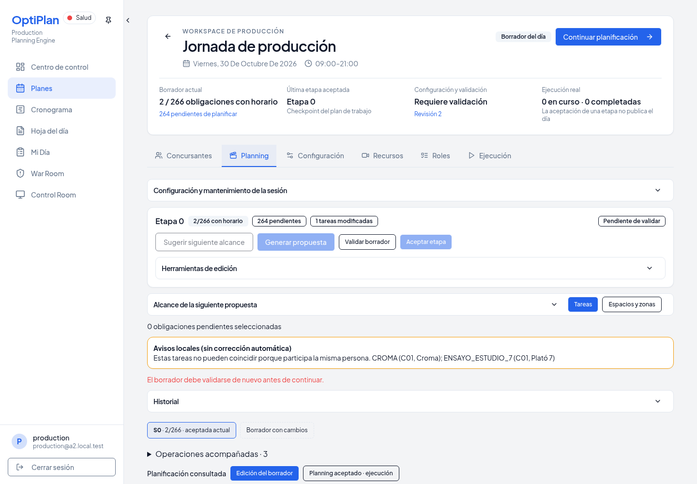

# UI-03A — Apartados plegables

Base autorizada: `c19a9c661124da7a291dff543b0ed4386f251228`.
Rama: `codex/day-workspace-collapsible-sections`. Destino: `main`.

## Implementación

`DayCollapsibleSection` reutiliza Radix Collapsible. El botón nativo ocupa la cabecera y aporta teclado, foco, `aria-expanded` y `aria-controls`; los botones de acción son hermanos del trigger. El contenido se monta al abrirlo por primera vez y permanece montado al cerrar, oculto también para navegación por teclado y lectores de pantalla.

Se aplica a alcance/selección, herramientas de edición, historial y mantenimiento de Assisted, y a Concursantes y la tabla administrativa de Tareas. La sugerencia de alcance muestra su selección; Revisar tarea conserva la apertura automática de la tabla existente. No se cambian operaciones, validadores, permisos, APIs ni persistencia de planificación.

La ficha deja de suscribirse al reloj de un segundo: sus valores sólo se pasaban como dos argumentos ignorados por `useUpdateTaskStatus`. Retirarlos evita reconciliar la tabla completa cada segundo al mantenerla montada. El hook writer y su payload `{status, expectedStatus}` permanecen intactos.

Las preferencias usan localStorage por usuario autenticado, jornada y sección, con defaults operativos: alcance y Concursantes abiertos; edición, mantenimiento, historial y tabla administrativa cerrados. El hook responde a cambios de identidad/jornada y eventos de almacenamiento de otras ventanas. Si el almacenamiento falla, mantiene la preferencia en memoria durante la sesión. Las preferencias son locales a este navegador.

Las acciones principales, progreso de etapas, estado de selección, validación, conflictos aceptados, avisos locales y resultados operativos quedan fuera del contenido plegable. Historial carga sus tiempos sólo al estar abierto; reaperturas reutilizan caché, y cambios en las identidades de etapas invalidan esa caché. Se conserva el reintento al reabrir tras error.

## Gate

- `npm run check`: PASS.
- `npm run build`: PASS; aviso de tamaño de bundle existente.
- Pruebas focales de preferencias, Assisted, alcance, edición y proyección: 26 PASS.
- Chromium A2: **PASS de UI**, con el guard manual `ASSISTED_DELTA_VALIDATION_UNSUPPORTED` conservado. El ensayo no certifica un informe estructurado de validación para ese caso; Aceptar etapa sigue bloqueado. Ver `collapsible-sections.json` e `integration.json`.

La prueba usa PostgreSQL, GoTrue, PostgREST y el servidor de producto reales, todos descartables. A2 27001 reproduce el snapshot histórico aceptado con 266 tareas para las comprobaciones visuales. A2 27002 conserva sus 266 identidades: dos tareas reciben horarios manuales mediante la API diaria antes de iniciar Assisted; se comprueba la selección pendiente y la configuración, y después se mueve una tarea planificada manteniendo su duración para provocar un conflicto real de Draft. Una jornada técnica independiente creada por las APIs verifica Revisar tarea → apertura automática de tabla. No hay seed de una solución completa ni nueva certificación del solver. Cero escrituras a servicios remotos.

Se compara literalmente SQL antes/después de las acciones visuales. La recarga mantiene el bootstrap de autenticación existente, que se registra por separado de cualquier writer de producto. El conflicto se limita al Draft descartable de 27002: no se acepta una etapa, no se reinicia ninguna propuesta y no se modifica su planning consolidado. Las filas de tareas del snapshot histórico y de las otras jornadas previas permanecen literales. El polling de jornada/ejecución y el bootstrap de autenticación ya existentes se registran aparte; el plegado no añade consultas ni writers de producto.

## Reproducción

```sh
git worktree add --detach work/ui03a-base c19a9c661124da7a291dff543b0ed4386f251228
ln -s "$PWD/node_modules" work/ui03a-base/node_modules
PLAYWRIGHT_CHROMIUM_EXECUTABLE_PATH=/usr/bin/chromium SECTIONS_BASELINE_ROOT="$PWD/work/ui03a-base" node --import tsx script/demo/smokeA2Integration.ts work/ui03a-gate --historical-topology --collapsible-sections
```

Requiere Docker local y las dependencias declaradas del proyecto. El runner crea y elimina sus propios contenedores y credenciales locales; no usa las credenciales Supabase conectadas.

## Capturas

| Superficie | Base | Candidato |
| --- | --- | --- |
| Assisted |  |  |
| Tareas |  |  |



## Límites e integración

Sin cambios en `planning-workspace-layout.tsx`, `fullscreen-planning-panel.tsx`, `planning-timeline.tsx`, `planning-workspace-preferences.ts` ni `index.css`. Sin dependencia pendiente de UI-01, sin rebase, merge ni despliegue. Recursos, Configuración, Personal y Ejecución quedan fuera de esta unidad.

No se ejecuta un nuevo Full A2 del motor: el cambio es visual. La prueba no sustituye la comprobación del navegador de producción ni certifica transporte Supabase Realtime; sí verifica eventos reales de localStorage entre ventanas.

## Archivos de implementación y pruebas

- Cliente: `client/src/components/day-workspace/day-collapsible-section.tsx`, `client/src/hooks/use-day-section.ts`, `client/src/lib/day-section-preferences.ts`, `client/src/lib/day-section-preferences.test.ts`, `client/src/components/planning/assisted-planning-workspace.tsx`, `client/src/pages/plan-details.tsx`.
- Gate: `script/demo/smokeCollapsibleSections.ts`, `script/demo/smokeA2Integration.ts`, `script/demo/smokeA2Journey.ts`, `script/demo/smokeA2ViewsHistoryJourney.ts`, `script/demo/smokeDayWorkspaceJourney.ts`. Los escenarios anteriores se adaptan a la preferencia de Historial y su nueva caché, conservando las comprobaciones de autoridad.

### Limitación observada en refresh

Durante la preparación se comprobó que el snapshot histórico usa intencionadamente un fingerprint marcador, por lo que no sirve para certificar validaciones actuales. No se debilitaron esos guards. En un ensayo separado, el RPC preexistente `assisted_apply_config_refresh` falló en el PostgreSQL 17 descartable por ausencia de `jsonb_object_length(jsonb)`. Esta unidad no modifica SQL ni certifica Aplicar refresh en ese entorno; sí comprueba la consulta real de comparación y su conservación al plegar. No se extrapola este resultado a la instancia Supabase conectada. La prueba final de conflicto usa la revisión real creada por el bootstrap de la jornada nueva.

El PR se entrega en borrador por esas limitaciones de certificación de backend. Las comprobaciones de UI, preferencias, guardas visibles y conservación de autoridades pasan; no se declara una nueva certificación completa de Assisted.
