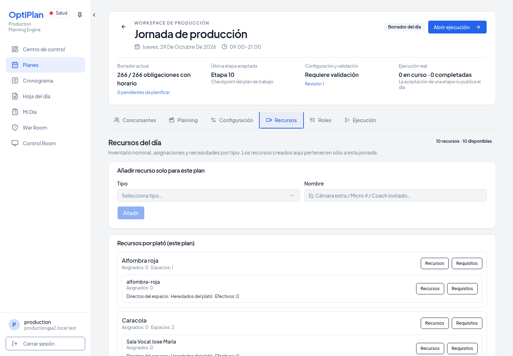
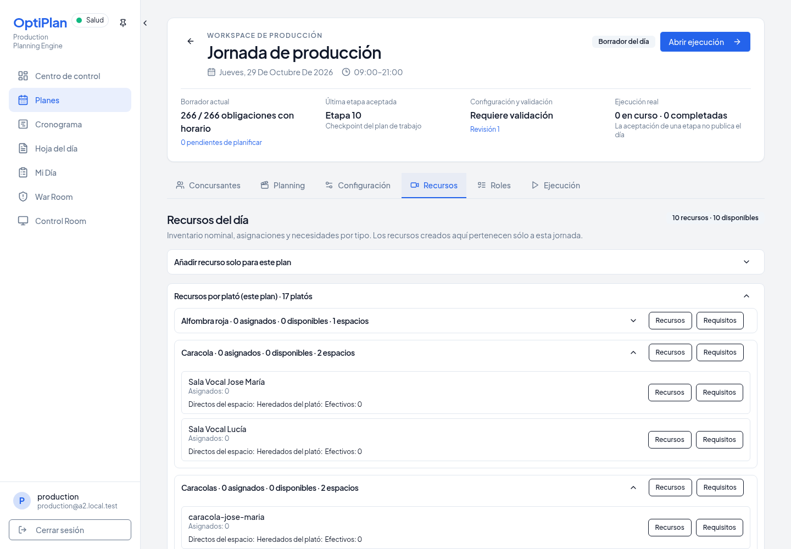
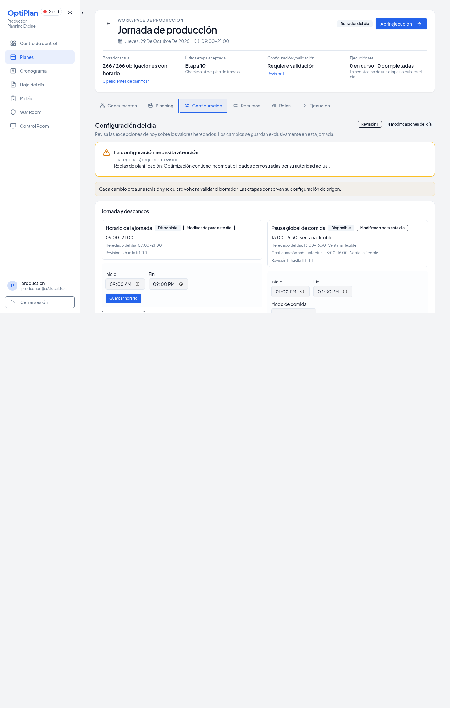
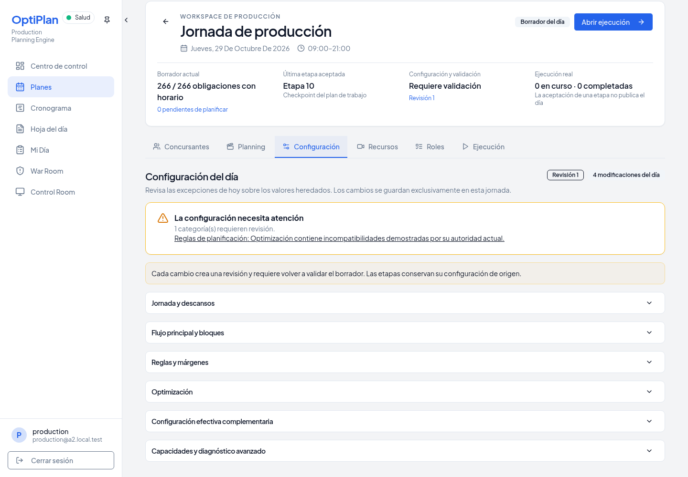
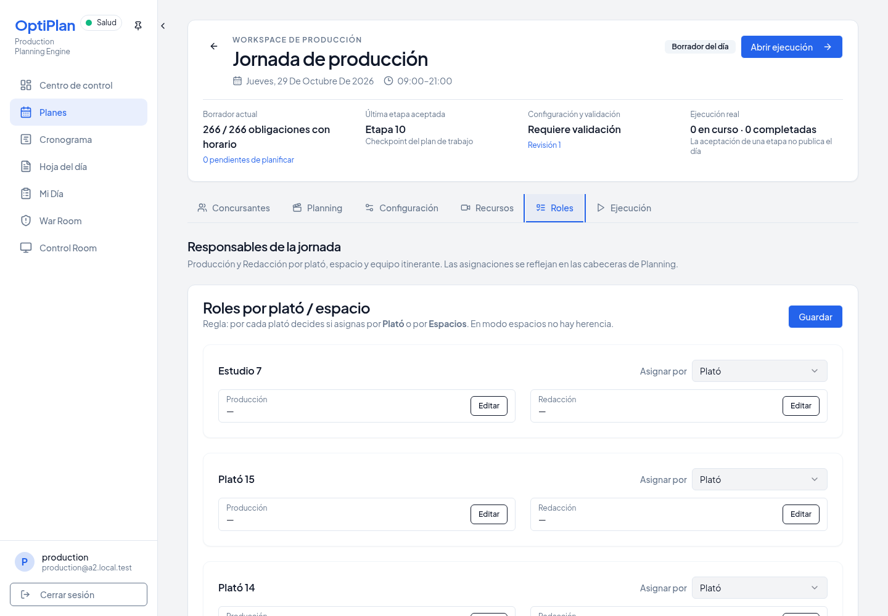
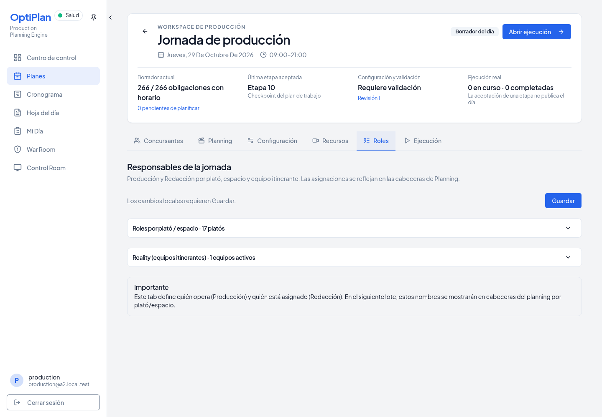
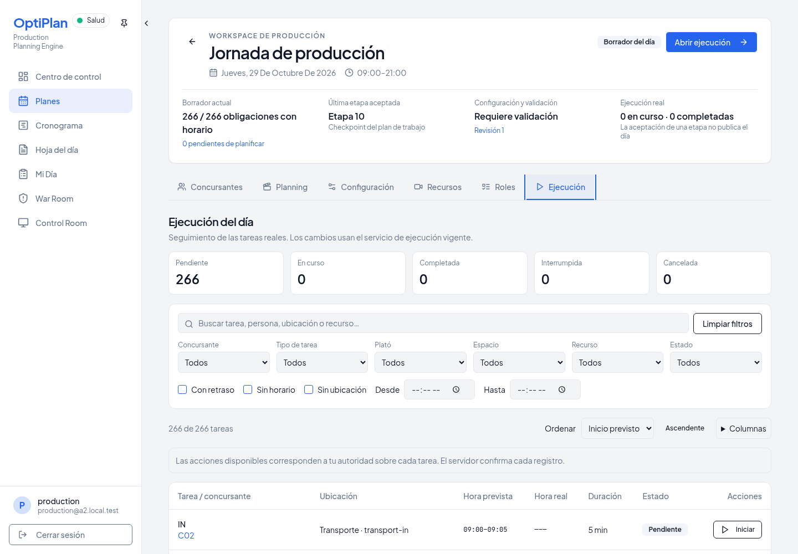
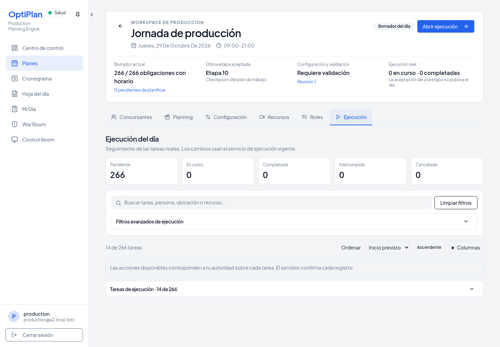

# UI-03B — Apartados plegables en el resto de la jornada

Base autorizada: `6353a2a2845610ee0f6bdc1bec6ee91a70af652d` (PR #1133 / UI-03A).
Rama remota: `codex/day-workspace-collapsible-remaining-tabs`. Destino: `main`.

## Implementación

Se reutilizan `DayCollapsibleSection`, `useDaySection` y el almacenamiento v1 existente. `PersistedDaySection` sólo une esas dos piezas dentro de un componente: permite usar grupos dinámicos sin llamar hooks dentro de bucles. Las claves incorporan usuario, jornada, pestaña/sección e IDs numéricos estables de plató, tipo de recurso y equipo; renombrar o reordenar grupos no altera su preferencia.

- **Recursos:** alta adicional, recursos por plató, cada plató y listados por tipo. Cabeceras con cantidades/disponibilidad; Recursos/Requisitos son acciones hermanas del trigger. Los diálogos y sus writers permanecen iguales. El renombrado adhoc conserva su guardado por blur habitual, excepto al pasar el foco a un encabezado plegable: conserva el nombre pendiente sin escribir por el cambio visual.
- **Configuración:** jornada/descansos, flujo/bloques, reglas/márgenes, optimización, complementaria y capacidades/diagnóstico. Revisión, readiness, permisos, aviso de revalidación y resultado/error de guardado permanecen visibles. Los enlaces con ancla abren y muestran su categoría; después se puede volver a cerrar. Los editores y payloads EDIT/RESTORE/REFRESH se conservan.
- **Responsables (pestaña Roles):** asignaciones por plató/espacio, cada plató, Reality y cada equipo activo. Guardar, estado y errores quedan fuera de los plegables. No se añaden niveles por cada picker ni por cada espacio.
- **Ejecución:** filtros avanzados y tabla de tareas. La tabla empieza abierta; búsqueda rápida, limpiar, orden, columnas, contadores, estado de autoridad/conexión y las alertas vigentes permanecen fuera. No hay plegables por tarea ni cambios de transiciones, writers, permisos o reloj.

El contenido se monta al abrir por primera vez y se conserva al cerrar. `hidden` retira los controles cerrados del recorrido de teclado; los encabezados son botones nativos con Enter/Space, foco visible, chevron y `aria-expanded`. Se fija además una relación `aria-controls`/`id` estable, porque la versión instalada de Radix omite su `aria-controls` por defecto cuando está cerrada. No se añaden contenedores de scroll.

Defaults: alta adicional, complementaria, capacidades y filtros avanzados cerrados; las secciones operativas y grupos dinámicos abiertos. Preferencias locales al navegador, conservando el aislamiento y fallback de UI-03A.

## Gate y autoridades

- `npm run check`: **PASS**.
- `npm run build`: **PASS** (aviso existente de bundle >500 kB).
- Tests focales de preferencias, ejecución y configuración: **16 PASS**.
- Chromium real, cuatro pestañas desktop y cuatro móviles (390 px): **PASS**.
- Teclado/ARIA, filtros, selectores, botones hermanos, borradores de recursos/configuración/responsables y equipo Reality activo: **PASS**.
- Preferencias tras pestañas/recarga, anclas de readiness repetidas, aislamiento de usuario/jornada y permisos admin/production/viewer: **PASS**.
- **59 tablas públicas idénticas**, cero writers operativos durante plegado/pestañas/recarga.
- EDIT/RESTORE/REFRESH explícitos: **HTTP 200**; avisos de revalidación, conexión y guardado fallido visibles con apartados cerrados.
- Quince capturas, cero errores JavaScript de página y cero escrituras remotas. Ver `validation.json`, `remaining-day-sections.json` e `integration.json`.

El ensayo usa PostgreSQL 17, GoTrue, PostgREST, servidor de producto y Chromium reales, todos locales y descartables. No hay interceptación de peticiones, cambios de RPC ni acceso a Supabase remoto. La jornada histórica 27001 mantiene 266 tareas y su Stage aceptado como fixture visual; no se presenta como una nueva solución del motor. La jornada 27002 se usa para las operaciones explícitas de configuración, separadas de las acciones visuales sin escritura.

Antes de tomar la huella SQL se recorren las cuatro pestañas para materializar las lecturas/arranques existentes. Después se comparan literalmente **todas las tablas públicas**, incluidas tareas, planificación, configuración, recursos, disponibilidad y responsables. `remaining-day-sections.json` recoge ambas huellas y las peticiones. Sólo se permite el bootstrap de autenticación existente al recargar; cualquier writer de producto durante plegado, pestañas o recarga hace fallar el smoke. Las operaciones explícitas finales se registran aparte.

## Reproducción

```sh
git worktree add --detach work/ui03b-base 6353a2a2845610ee0f6bdc1bec6ee91a70af652d
ln -s "$PWD/node_modules" work/ui03b-base/node_modules
PLAYWRIGHT_CHROMIUM_EXECUTABLE_PATH=/usr/bin/chromium SECTIONS_BASELINE_ROOT="$PWD/work/ui03b-base" node --import tsx script/demo/smokeA2Integration.ts work/ui03b-gate --historical-topology --remaining-day-sections
```

Requiere Docker local y las dependencias ya declaradas. El runner crea/elimina sus contenedores y credenciales. `smokeRemainingDaySections.ts` es un recorrido independiente; el runner compartido sólo añade una opción y su dispatch, sin modificar los recorridos existentes de UI-01/UI-03A.

## Capturas

| Pestaña | Base | Candidato |
| --- | --- | --- |
| Recursos |  |  |
| Configuración |  |  |
| Responsables |  |  |
| Ejecución |  |  |

[Móvil Recursos](after-mobile-resources.png) · [Móvil Configuración](after-mobile-configuration.png) · [Móvil Responsables](after-mobile-staff.png) · [Móvil Ejecución](after-mobile-execution.png) · [Plegables de Ejecución en móvil](after-mobile-execution-sections.png).

[Conexión perdida con tabla cerrada](after-execution-offline.png) · [Error de guardado con editor cerrado](after-configuration-save-error.png).

## Archivos e integración

Cliente: `day-collapsible-section.tsx`, `day-resources-workspace.tsx`, `day-staff-workspace.tsx`, `day-execution-workspace.tsx`, `effective-configuration.tsx`, `use-day-section.ts` y `day-section-preferences.ts`.

Pruebas: `day-section-preferences.test.ts`, `script/demo/smokeRemainingDaySections.ts` y el dispatch aditivo en `script/demo/smokeA2Integration.ts`. Evidence en esta carpeta.

No se modifica ninguno de los siete archivos protegidos de UI-01: `planning-workspace-layout.tsx`, `fullscreen-planning-panel.tsx`, `planning-timeline.tsx`, `planning-workspace-preferences.ts`, `plan-details.tsx`, `assisted-planning-workspace.tsx`, `index.css`. Sin cambios de APIs, SQL, migraciones, RLS, EngineInput, Planner, validadores o contratos.

Riesgo de integración limitado a posibles conflictos textuales si UI-01 amplía también el runner compartido. No se hace rebase/merge con UI-01; no hay un detalle funcional pendiente que requiera sus archivos protegidos.

## Límites

No se ejecuta Full A2 del solver: las autoridades operativas permanecen idénticas durante el recorrido visual. La prueba no certifica Supabase Realtime/WebSocket ni el navegador de producción. Los borradores sobreviven al plegado y cambio de pestaña dentro de la sesión; la recarga conserva las preferencias visuales, sin añadir persistencia de borradores que no existía en el producto.

El error de guardado se provoca desconectando únicamente el endpoint PUT de configuración mediante condiciones de red CDP de Chromium. No se interceptan respuestas ni se falsea el servidor; las lecturas siguen disponibles y `navigator.onLine` permanece verdadero. Así se prueba un fallo real de transporte en lugar de la pausa offline normal de React Query.

Sin merge ni despliegue/publicación.
