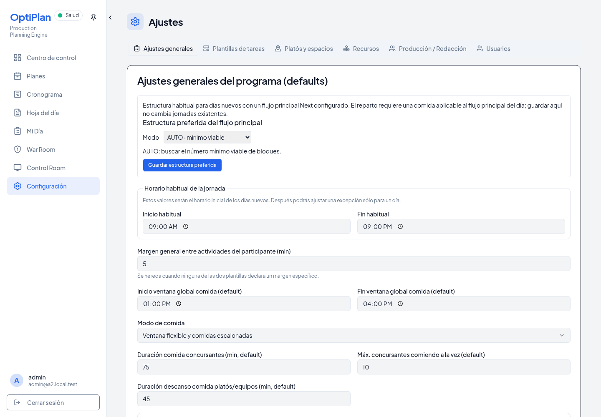
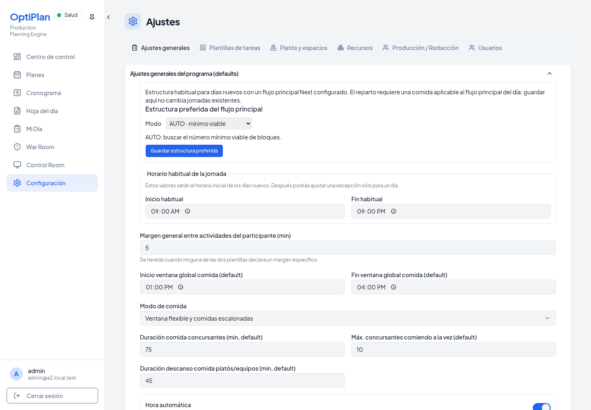
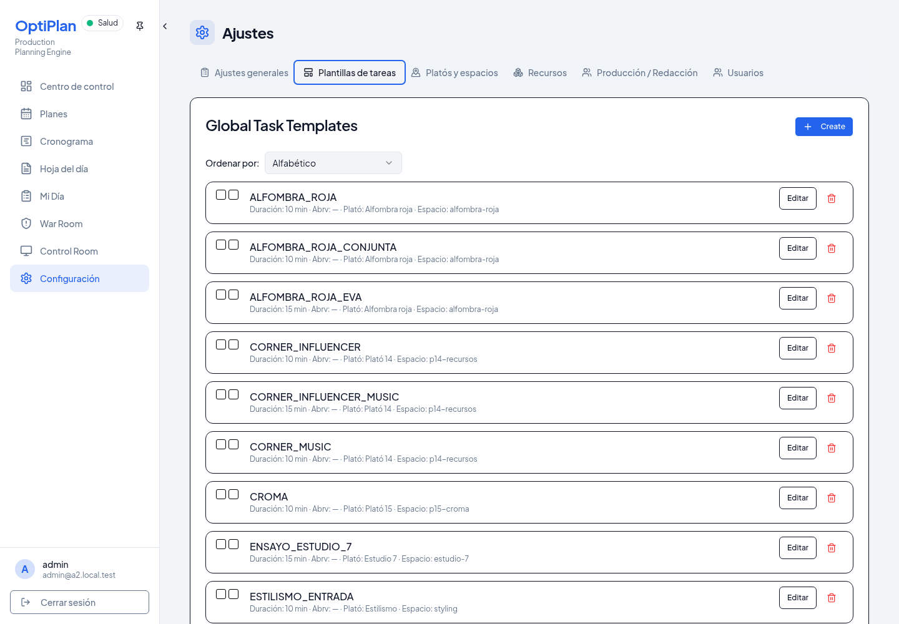
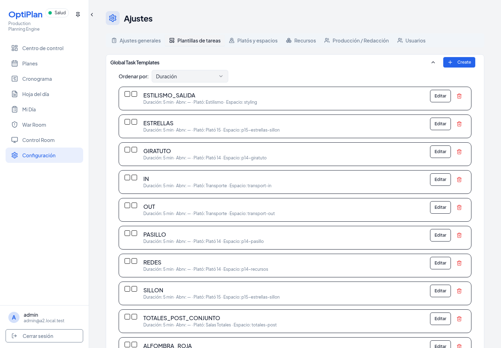
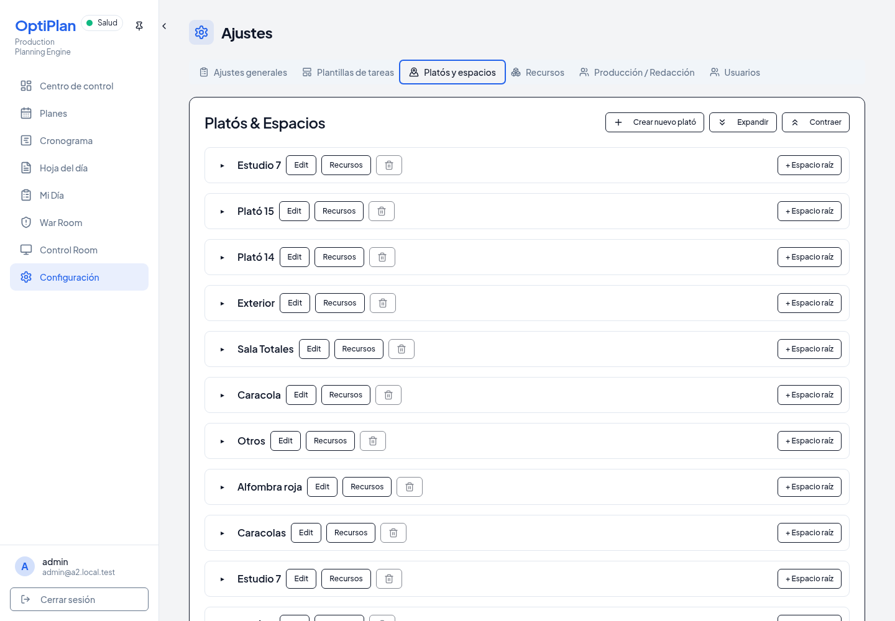
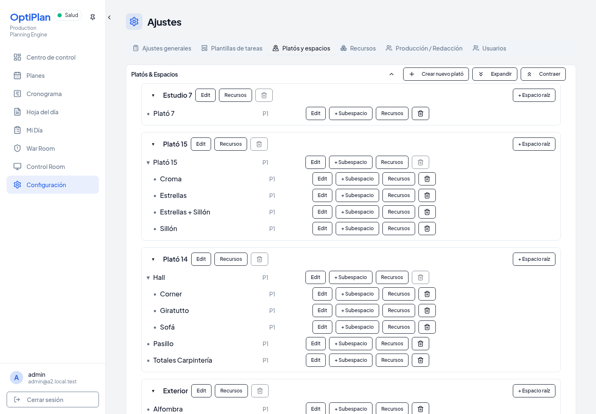
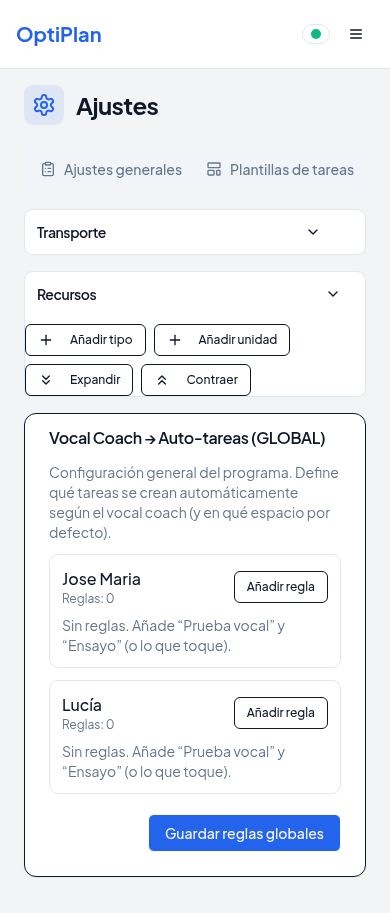
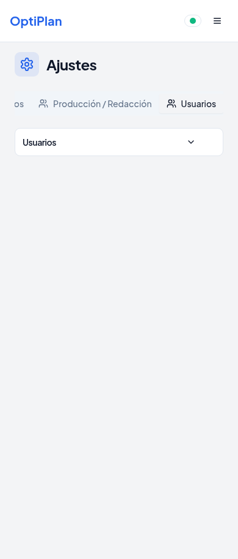
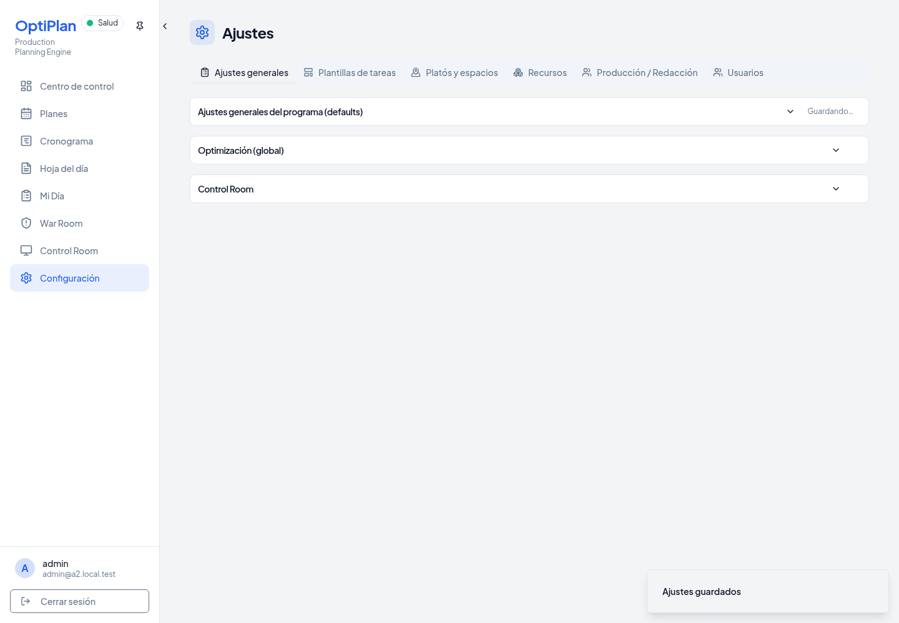
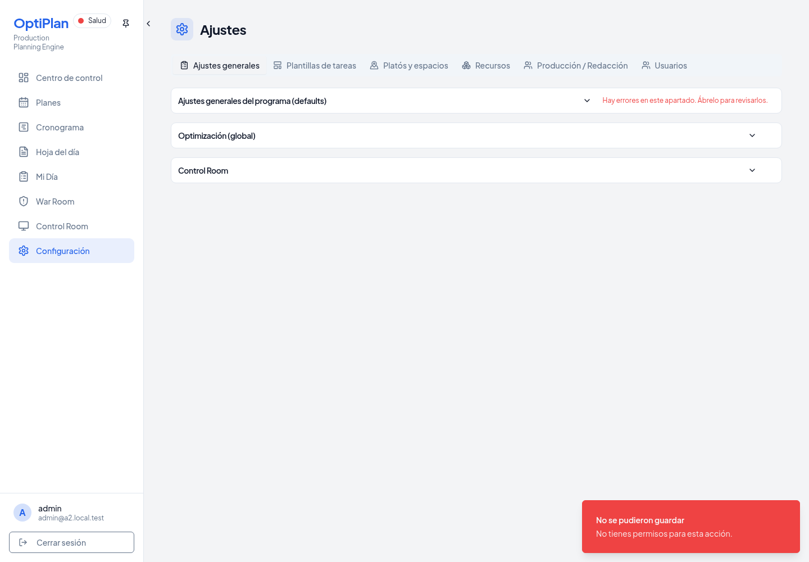

# UI-03C — Configuración global plegable

Base autorizada: `6353a2a2845610ee0f6bdc1bec6ee91a70af652d`.
Rama remota: `codex/global-settings-collapsible-top-level`. Destino: `main`.

## Implementación

Doce apartados en las seis pestañas existentes: programa, optimización, Control Room, catálogo de plantillas, platós/espacios, orden de columnas, transporte, catálogo de recursos, personas, equipos itinerantes, defaults de responsables y usuarios. El catálogo de reglas Vocal Coach conserva su panel actual. Se conservan los desplegables interiores por plató, recurso y editor, y las acciones de creación, componentes y confirmación.

`SettingsSection` reutiliza `DayCollapsibleSection` sin modificarla. La primitiva coincide literalmente con la base UI-03A. `main` y la rama autorizada coincidían con esa base al preparar esta unidad; UI-03B no estaba integrada ni se ha copiado. No se modifican hooks/preferencias de jornadas, módulos de planificación, motor, endpoints, esquema, migraciones ni RLS.

La preferencia local usa `optiplan:settings-section:v1:<usuario>:<apartado>`, sin jornada ni plan ficticios. Los apartados empiezan abiertos para conservar la disponibilidad inicial anterior. Responde a cambios de usuario y eventos de almacenamiento entre ventanas; ante almacenamiento bloqueado o lleno usa memoria de sesión. El borrado de una preferencia recupera el default abierto.

El contenido visitado permanece montado al plegar. Las pestañas inactivas mantienen su ciclo de montaje previo: no se promete conservar borradores al cambiar de pestaña ni después de recargar. Los botones de acción son hermanos del trigger nativo. Se conservan Enter/Espacio, `aria-expanded`, `aria-controls`, foco visible y contenido cerrado fuera de la navegación accesible.

Transporte y nombres de recursos conservan sus writers `onBlur` y payloads. El wrapper intercepta únicamente el blur cuyo destino es una cabecera de apartado global; así plegar o enfocar otra cabecera no guarda ni borra el borrador. Los restantes cambios de foco conservan su comportamiento. Los debounces y guardados iniciados previamente por una edición conservan su curso. No se cambian reglas operativas ni mecanismos de guardado.

Los indicadores de guardado y los avisos de error permanecen en la cabecera, fuera del contenido oculto. Las altas de recursos propagan sólo su estado de presentación a la cabecera; sus operaciones permanecen intactas. Los avisos/toasts y diálogos existentes siguen disponibles. El panel Usuarios conserva exactamente el gate admin previo; los demás roles siguen sin acceso a Configuración.

## Reproducción

```sh
git worktree add --detach work/ui03c-base 6353a2a2845610ee0f6bdc1bec6ee91a70af652d
ln -s "$PWD/node_modules" work/ui03c-base/node_modules
PLAYWRIGHT_CHROMIUM_EXECUTABLE_PATH=/usr/bin/chromium \
SETTINGS_SECTIONS_BASELINE_ROOT="$PWD/work/ui03c-base" \
node --import tsx script/demo/smokeA2Integration.ts work/ui03c-gate --historical-topology --settings-sections
```

El runner crea y elimina PostgreSQL, GoTrue y PostgREST locales. Sobrescribe en sus procesos todas las credenciales de Supabase con credenciales aleatorias descartables. Usa login real, catálogo histórico existente y HTTP de producto, sin mocks de endpoints. Las operaciones CRUD afectan sólo a registros de prueba o defaults de esa base temporal; no a producción ni jornadas A2 remotas. Las jornadas históricas locales quedan bajo las comprobaciones de preservación del harness anterior.

Los guardados lentos se observan reteniendo brevemente un lock SQL en una segunda conexión a esa base. El error de guardado se produce retirando temporalmente el rol del administrador descartable: la respuesta real es 403, sin sustituir el backend. No se alteran las autoridades de producción para acomodar el ensayo.

## Evidencia y límites

Los resultados del candidato se encuentran en `settings-sections.json`, `integration.json` y `validation.json`. Las capturas comparan el mismo catálogo y viewport en base/candidato. Los logs privados y credenciales temporales permanecen fuera del commit.

No se certifica un despliegue ni se ejecuta Full A2 del motor: esta unidad cambia presentación. La prueba móvil comprueba las cabeceras y su navegación en un viewport de 390 px; las tablas/editoriales interiores conservan el comportamiento responsive previo. La persistencia es local al navegador, no una preferencia sincronizada en servidor.

No se realiza merge ni publicación.

## Gate del candidato

- `npm run check`: **PASS**.
- Tipado del harness de integración: **PASS**.
- `npm run build`: **PASS**, con el aviso existente de tamaño de bundle.
- Preferencias nuevas/de jornada, ajustes generales, permisos, contratos y snapshots de plantillas y disponibilidad de recursos: **32 PASS, 0 FAIL**.
- Chromium real: **PASS**, doce apartados y seis pestañas; Enter/Espacio, ARIA, foco, contenido oculto, recarga, sincronización entre ventanas, borrado de preferencias y aislamiento entre administradores.
- Navegación/plegado: **0 writers operativos**, con huellas de **todas las tablas públicas iguales** antes/después. El bootstrap de autenticación al recargar/abrir otra ventana se registra aparte; no lo causa el plegado.
- Borradores: los seis campos `onBlur` de transporte, nombre de recurso, creación/edición de plantilla, personas, equipos, responsables, platós/espacios y rol de usuario conservan su estado al plegar. Se conserva la ordenación de plantillas y la expansión interior de platós/recursos. Un horario inválido mantiene aviso exterior.
- CRUD real en registros descartables: personas, equipos, plantillas, tipos/unidades de recurso, platós/espacios y rol/eliminación de usuario. Se prueban cancelaciones de edición y confirmaciones. El diálogo de componentes sigue accesible. Los recursos se archivan por la operación productiva existente; sólo los probes recién creados se retiran por SQL al limpiar el ensayo.
- Guardado explícito del programa: payload idéntico al baseline y resultado SQL comprobado. Renombrar recurso conserva `{name}`; guardar rol conserva `{roleKey}`; plantillas conservan margen explícito cero. Guardar, borrar y cancelar siguen sus endpoints previos.
- Guardado retenido por lock SQL y error real 403: feedback exterior visible con el apartado cerrado. Se restaura el rol temporal y el default modificado.
- La jornada histórica local de 266 tareas/11 Stages, las 333 tareas de otra jornada y el catálogo protegido terminan literales. **0 escrituras remotas**.

## Capturas

| Superficie | Base | Candidato |
| --- | --- | --- |
| General |  |  |
| Plantillas |  |  |
| Platós/espacios |  |  |






## Archivos

- Primitiva/adaptador: `client/src/components/settings/settings-section.tsx`; preferencias y hook específicos de Configuración global.
- Superficies: `settings.tsx`, ajustes generales/optimización/Control Room/transporte, `resources-list.tsx`, `create-resource-pool.tsx` y `settings/users-admin.tsx`.
- Pruebas: preferencias y `script/demo/smokeSettingsSections.ts` / `smokeSettingsOperations.ts`, integradas en el harness descartable existente con `--settings-sections`.
