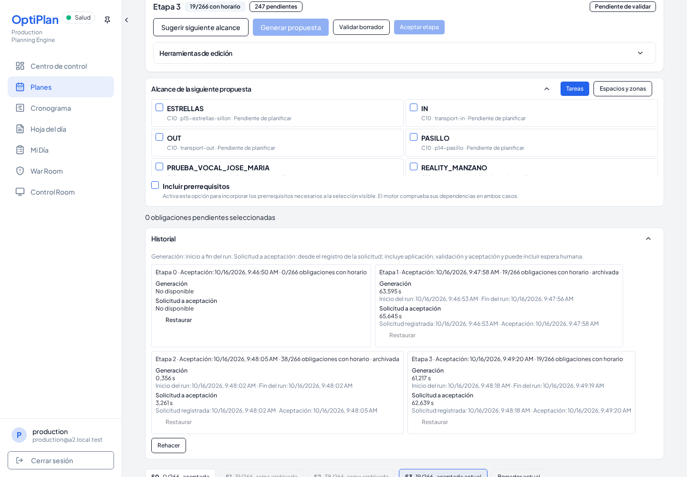
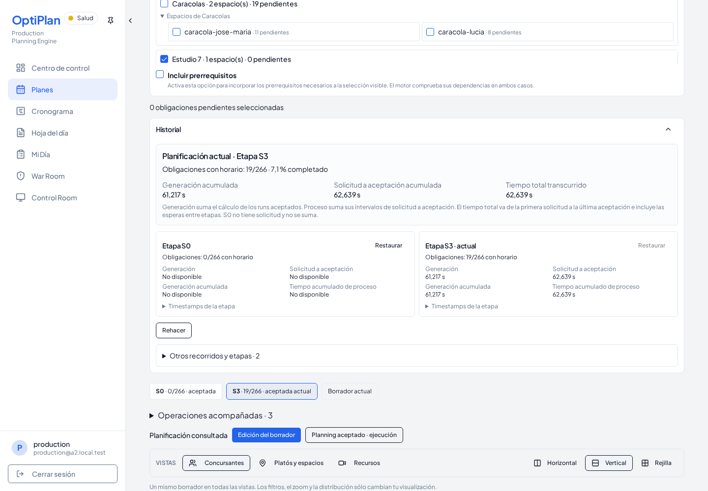
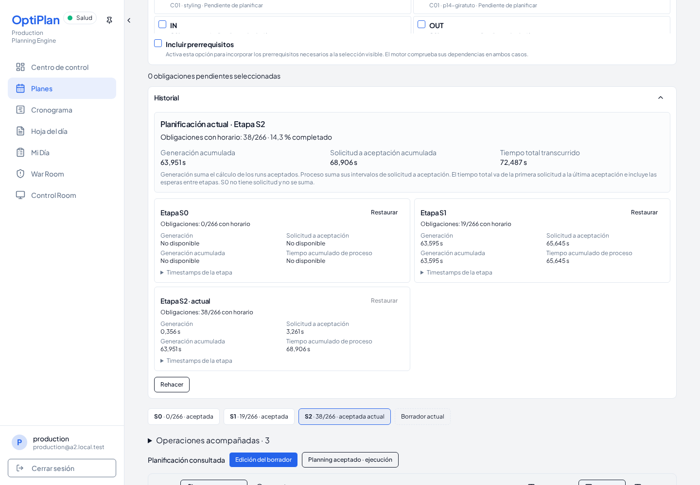
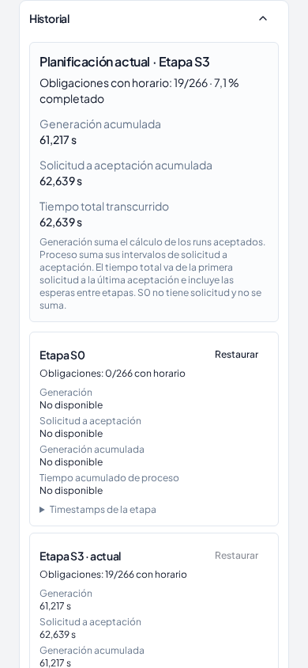

# UI-04 — Historial actual y tiempos acumulados de Assisted

Base: `c1cf4359fe721c60f30244f90a73989e37018282`. Unidad limitada a Historial, su tira de progreso y sus helpers/pruebas. No cambia endpoints, payloads, SQL productivo, búsqueda, aceptación, archivado ni publicación.

La causa era renderizar `state.history` completo: mezclaba ancestros, futuros restaurables y ramas archivadas. El recorrido actual se obtiene exclusivamente siguiendo `parentStageId` desde `activeStage` hasta S0. El algoritmo existente de `assistedAcceptedBaseline` se extrae sin cambiar su comportamiento a `shared/assistedStageLineage.ts`; servidor y presentación lo reutilizan. El orden visible invierte esa ruta, sin deducir parentesco por ordinal ni timestamp. La tira de progreso utiliza la misma ruta. Las demás etapas siguen accesibles en un desplegable cerrado por defecto, con sus condiciones originales de restauración/rehacer.

`shared/assistedHistory.ts` es puro y no modifica sus entradas. Comprueba padres ausentes, ciclos, duplicados y raíces incoherentes. Un linaje inválido muestra aviso y deja todos los acumulados no disponibles. El resumen de obligaciones usa el snapshot completo de la etapa aceptada actual, sin contar una propuesta ni el Draft pendiente.

Los tres tiempos tienen semánticas distintas:

- Generación acumulada: suma de `finished_at − started_at` de los runs vinculados a las etapas de la ruta.
- Proceso acumulado: suma de `accepted_at − created_at` de esos runs; incluye aplicación, validación y espera humana dentro de cada etapa.
- Tiempo total transcurrido: última aceptación menos primera solicitud; incluye también esperas entre etapas. Se muestra solo cuando toda la ruta posterior a S0 tiene intervalos de proceso verificables.

S0 no tiene solicitud y no aporta un cero ficticio. Un run/timestamp ausente produce «No disponible» o una suma con cobertura parcial explícita, calculada sobre las etapas posteriores a S0. Un cero medido sí permanece cero. Se reutiliza el parser temporal existente; se rechazan duraciones que no coinciden con sus extremos y cronologías incoherentes. No se suman tiempos de las etapas secundarias. Los timestamps detallados quedan en un `details` nativo, cerrado por defecto y accesible por teclado.

## Reproducción

Preparar un checkout limpio de la base con sus dependencias en `UI04_BASELINE_ROOT`. Luego:

```sh
UI04_BASELINE_ROOT=/ruta/base node --import tsx script/demo/smokeA2Integration.ts /tmp/ui04-evidence --assisted-history
npm run check
npm run build
node --import tsx --test shared/assistedHistory.test.ts shared/assistedStageTiming.test.ts server/assistedAcceptedBaseline.spec.ts server/assistedHistoryTimings.spec.ts server/assistedRestart.spec.ts server/assistedManualSnapshotFidelity.spec.ts client/src/components/planning/stage-history-timing.test.ts
```

El harness compartido `smokeA2Integration.ts` permanece intacto. El nuevo flag se despacha desde `smokeA2Journey.ts` a `smokeAssistedActiveHistory.ts`, después de generar/aceptar S1/S2 por el flujo real. Usa PostgreSQL, GoTrue, PostgREST, servidor productivo y Chromium descartables. No sustituye respuestas ni introduce un planning resuelto, y no modifica el presupuesto del motor. La captura de la base usa otro servidor del mismo checkout verificado contra la misma base descartable; un proxy local solo adapta su cabecera CORS y reenvía Auth/REST al stack real.

Las lecturas visuales se comprueban con ausencia de requests operativos de escritura y comparación literal de filas y `xmin` antes/después, incluyendo sesiones, Stages, tareas, runs, validaciones, revisiones, excepciones y locks. Las operaciones explícitas de restaurar, rehacer, reiniciar y aceptar sí usan sus writers productivos existentes. Las 266 identidades se conservan, al igual que snapshots, relaciones y timestamps originales de los Stages; el archivado del futuro al aceptar la nueva rama sigue siendo el nativo.

## Límites

El gate no certifica una publicación ni Realtime; prueba recarga y consulta HTTP. Los timestamps ausentes/corruptos y los ciclos se cubren con pruebas focales sin corromper Stages inmutables en SQL. No se ejecuta Full A2 de once etapas para esta unidad de presentación. Los avisos habituales de tamaño de bundle permanecen. No se hace merge ni se publica en Replit.

## Resultado del candidato

`npm run check`, `npm run build`, tipado del harness y **27 pruebas focales: PASS**. Chromium real: **PASS** en escritorio 1440 × 1000 y móvil 390 × 844, incluidos teclado, recarga y controles de restauración/rehacer. Las consultas de Historial conservan valores y `xmin`; **0 requests visuales de escritura operativa** y **0 escrituras remotas**. Se conservan las 266 identidades y los 3 Stages originales; la aceptación posterior al reinicio añade un cuarto Stage.

Ejemplo real de S0 → S1 → S2, contrastado con metadatos SQL:

- Generación acumulada: **63951 ms**.
- Proceso acumulado: **68906 ms**.
- Tiempo total de reloj: **72487 ms**.

La nueva rama S0 → S3 solo suma su propio run; S1 y S2 quedan en el desplegable secundario. Los valores por escenario y la cobertura están en `history-ui04.json`; el ensayo completo y hashes, en `integration.json` y `validation.json`.








