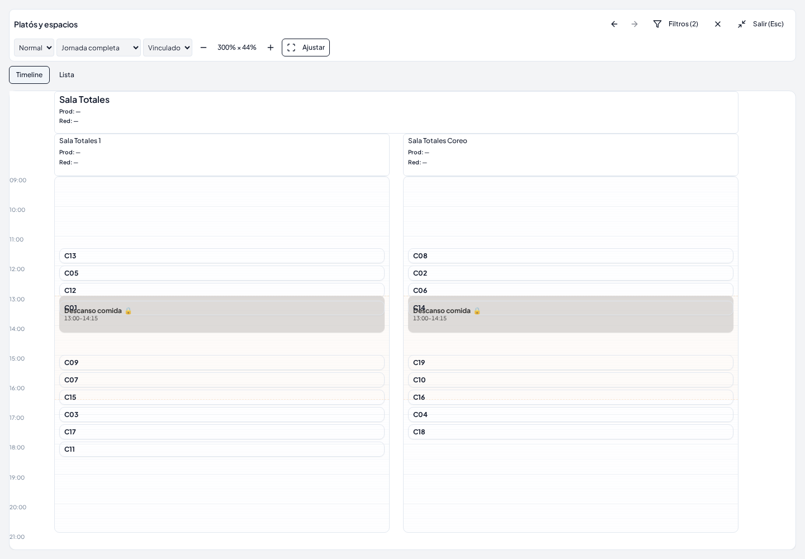
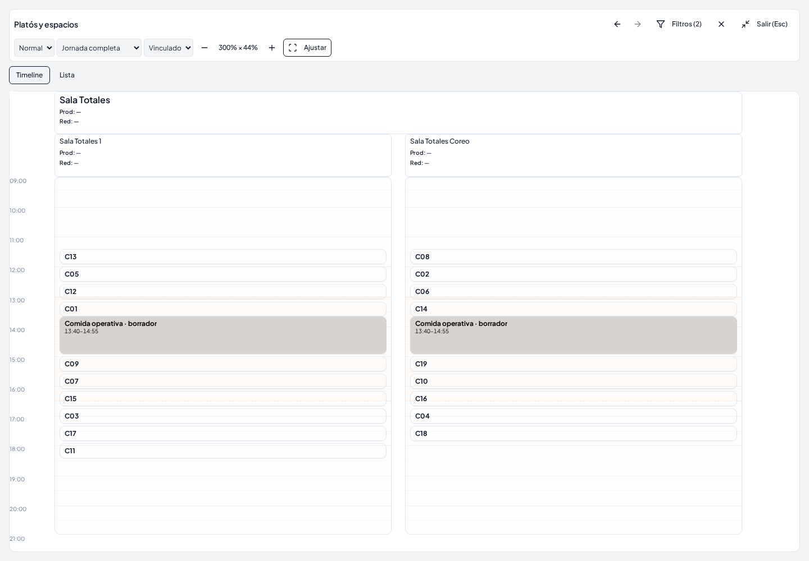

# UI-05 — Autoridad visual de comidas operativas

Base verificada: `7765e3cf02cfeadbad728aecc1d64397dbb2e6ed`. Rama: `codex/assisted-operational-meal-visual-authority`.

## Causa y recorrido

En A2 27002, el GET de `plan_breaks` devuelve 52 filas: 49 pausas de espacios con `13:00–14:15` y tres pausas itinerantes sin materializar. El snapshot del Stage activo S22 contiene las ocho decisiones reales. La consulta conectada fue exclusivamente REST GET; los datos privados descargados permanecen en `work/`.

El recorrido comprobado es `plan-details → AssistedPlanningWorkspace → PlanningWorkspaceLayout → PlanningTimeline.timelineTasks`. Antes, `timelineTasks` convertía directamente `plan.breaks` en tarjetas. El backend ya aplica `legacyBreaksForEngineInput`: una configuración estructurada sustituye las pausas legacy no protegidas y conserva el error ante locks incompatibles. No se cambia ese comportamiento.

La presentación ahora selecciona la autoridad una vez en `AssistedPlanningWorkspace`: `activeStage.snapshotJson` para Planning aceptado; `state.draft` (o `session.draftSnapshotJson`) para edición. `displayDraft` sigue siendo la vista previa de placements; no aporta decisiones de comida. `planning-operational-meals.ts` resuelve el `policyId` materializado contra la identidad `break:${policy.id}` de `plannerNextConfiguration.operationalMealPolicies` y entrega un contrato visual común a todas las vistas y variantes.

Las horas proceden exclusivamente de `startPlanned/endPlanned`. No se lee la ventana para construir una pausa. Cada espacio explícito obtiene una proyección de la misma identidad lógica; Totales 1 y Coreo representan una sola decisión, con el mismo intervalo. Los recursos se muestran exclusivamente por `planResourceItemIds`, sin heredar recursos por zona/espacio ni asignaciones de personal. Un equipo resulta afectado por la intersección de sus miembros explícitos en `itinerantTeamAvailability`; una recomposición puede mostrar la indisponibilidad de dos políticas existentes, conservando sus identidades, sin crear una comida propia ni inferir por nombre.

Las proyecciones son `div` sin acciones, menú, arrastre ni identidad de tarea operativa. No se mezclan con la contabilización de las 266 tareas. `Ocultar vacíos` y el catálogo de filtros incluyen espacios con una comida efectiva aunque no contengan trabajo productivo.

El ensayo detectó además que Planning aceptado ocultaba las zonas sin `uiOrderIndex`. Una zona con una comida efectiva se conserva ahora después de las zonas ordenadas, usando exclusivamente su ubicación explícita. La misma protección se aplica a equipos afectados con comida materializada; no se cambia el criterio legacy de grupos vacíos.

## Fallback y ausencias

- Sin configuración estructurada y con snapshot legacy que omite `operationalMeals`: se conserva el renderer legacy de `plan.breaks`.
- Con configuración estructurada, un snapshot ausente, vacío o antiguo no reactiva pausas legacy.
- Una decisión sin política resoluble, una política sin ámbito, IDs duplicados o un intervalo ausente/ilegible quedan pendientes/no disponibles, sin tarjeta con hora inventada.
- Las tarjetas del borrador se identifican como borrador; las aceptadas se identifican como aceptadas. Una propuesta pendiente no certifica comidas nuevas.
- Rollback, redo, reinicio y recarga vuelven a resolver los snapshots devueltos por el flujo existente. No se añade estado persistente de comidas en el cliente.

## Reproducción

El fixture comprimido `script/demo/fixtures/ui05-a2-s22.json.gz` conserva los doce snapshots originales del linaje S0 → S12…S22, las 266 identidades, sus referencias de plantilla y la configuración explícita del día. Excluye usuarios, contactos, comentarios y filas operativas privadas. Es una reproducción de decisiones aceptadas para probar presentación; no demuestra una nueva generación de S22.

El harness utiliza las migraciones completas y servicios PostgreSQL, GoTrue y PostgREST descartables. Prepara los snapshots como fixtures iniciales y conserva sus objetos/fingerprints durante las pruebas. La configuración del fixture se inserta al crear el día, respetando su trigger de inmutabilidad. Restaurar/rehacer/reiniciar usa después los endpoints y botones productivos, exclusivamente sobre esa base local.

```sh
git worktree add --detach /ruta/base-ui05 7765e3cf02cfeadbad728aecc1d64397dbb2e6ed
mkdir /ruta/base-ui05/node_modules
for dependency in "$PWD"/node_modules/* "$PWD"/node_modules/.bin; do
  ln -s "$dependency" "/ruta/base-ui05/node_modules/$(basename "$dependency")"
done
PLAYWRIGHT_BROWSERS_PATH="$PWD/work/browsers" npx playwright install chromium
PLAYWRIGHT_BROWSERS_PATH="$PWD/work/browsers" UI05_BASELINE_ROOT=/ruta/base-ui05 node --import tsx script/demo/smokeA2Integration.ts work/ui05-integration --historical-topology --operational-meals
node --import tsx --test client/src/lib/planning-operational-meals.test.ts client/src/lib/assisted-planning-view.test.ts client/src/lib/planning-view-policy.test.ts client/src/lib/planning-workspace-geometry.test.ts client/src/lib/planning-workspace-preferences.test.ts client/src/lib/planning-space-presentation.test.ts client/src/components/planning/assisted-planning-workspace.test.ts client/src/components/planning-timeline-assisted-drag.test.ts client/src/components/planning/space-task-content.test.tsx shared/assistedHistory.test.ts
npm run check
npm run build
```

El servidor de la base y el candidato consultan el mismo SQL descartable, sin interceptar respuestas. Las comprobaciones visuales auditan requests operativos y comparan filas completas y `xmin` en diez tablas, incluido `plan_breaks`. Los writers explícitos de restauración/reinicio se separan de esos bloques de lectura. Al final se contrastan las 266 identidades y los snapshots aceptados contra sus valores iniciales.

Los paquetes instalados se reutilizan con cachés `.vite` independientes para cada servidor. El día legacy de prueba tiene una sesión existente, sin `operationalMeals` ni configuración estructurada; no se usa este gate para certificar el bootstrap de su configuración antigua.

## Intervalos S22 esperados

| Política | Inicio | Fin |
|---|---|---|
| Reality A | 13:00 | 14:15 |
| Reality B | 14:50 | 16:05 |
| Coach Lucía | 14:20 | 15:05 |
| Coach José María | 14:50 | 15:35 |
| Estudio 7 | 14:50 | 16:05 |
| Plató 14 | 15:15 | 16:30 |
| Plató 15 | 14:50 | 16:05 |
| Totales (ambos espacios) | 13:40 | 14:55 |

## Límites

La consulta conectada contrasta los datos de origen; la navegación y los writers se ensayan en servicios locales. No se ejecuta Full A2 ni se vuelve a generar una solución para una corrección de presentación. La exclusión de comidas de una propuesta se prueba en el wiring focal; el ensayo no genera una nueva propuesta del motor. No se certifican Realtime, publicación ni el navegador del despliegue remoto. No se modifica Engine, Assisted backend, validación, búsqueda, presupuestos, schema, reglas, Stages o filas operativas del proyecto conectado. Sin merge ni publicación.

## Resultado

`npm run check`, `npm run build`, **43 pruebas focales y Chromium real: PASS**. Los avisos habituales de tamaño de bundle permanecen. El ensayo certifica las ocho políticas de S22, borrador/aceptado, Timeline/Lista, recursos y equipos recompuestos, filtros, zoom, maximización, ocultar vacíos, recarga, rollback a S12, diez pasos de redo hasta S22, reinicio a S0 y fallback legacy.

**0 escrituras visuales operativas y 0 escrituras remotas**. Seis bloques visuales comparan filas completas y `xmin` en diez tablas. Los snapshots/fingerprints aceptados y las 266 identidades permanecen iguales. El día anterior con 11 Stages, las 333 tareas de otro día y el catálogo histórico también permanecen literales. `source-read-equality.json` contrasta además valores conectados antes/después en siete tablas, incluidos los 23 Stages y las 52 pausas del día real.

Los resultados reproducibles están en `operational-meals.json`, `integration.json`, `validation.json` y los logs focales/check/build. Las capturas usan exactamente el mismo SQL, filtro y encuadre:




