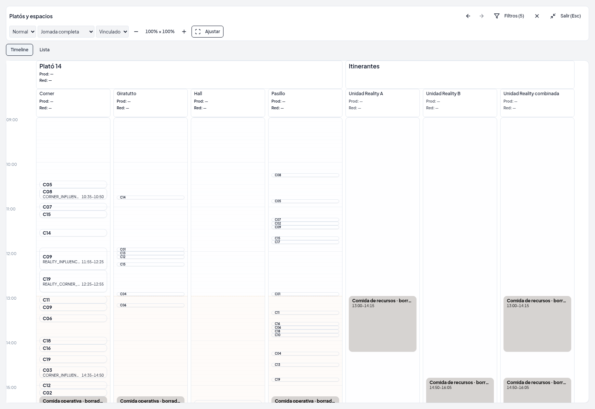
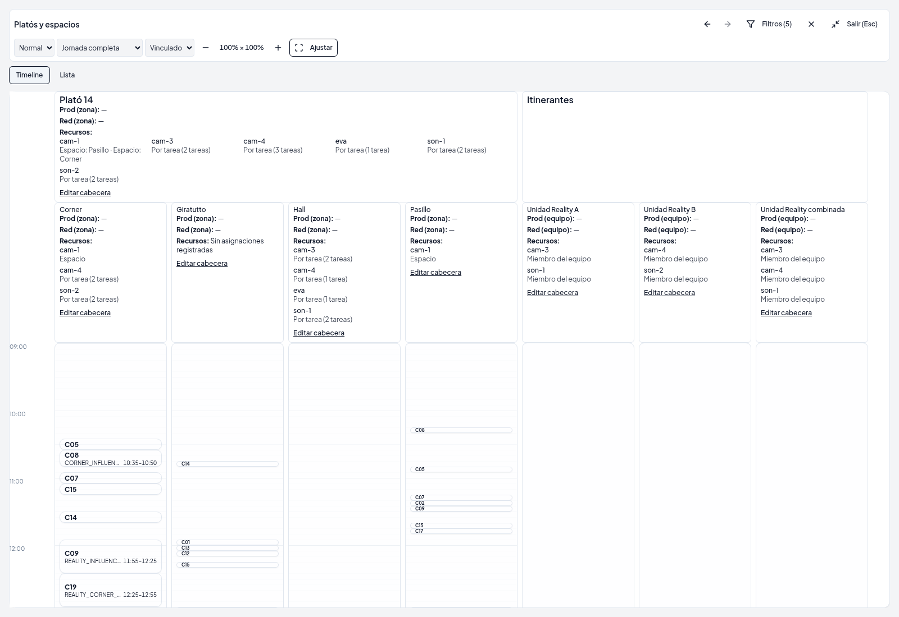
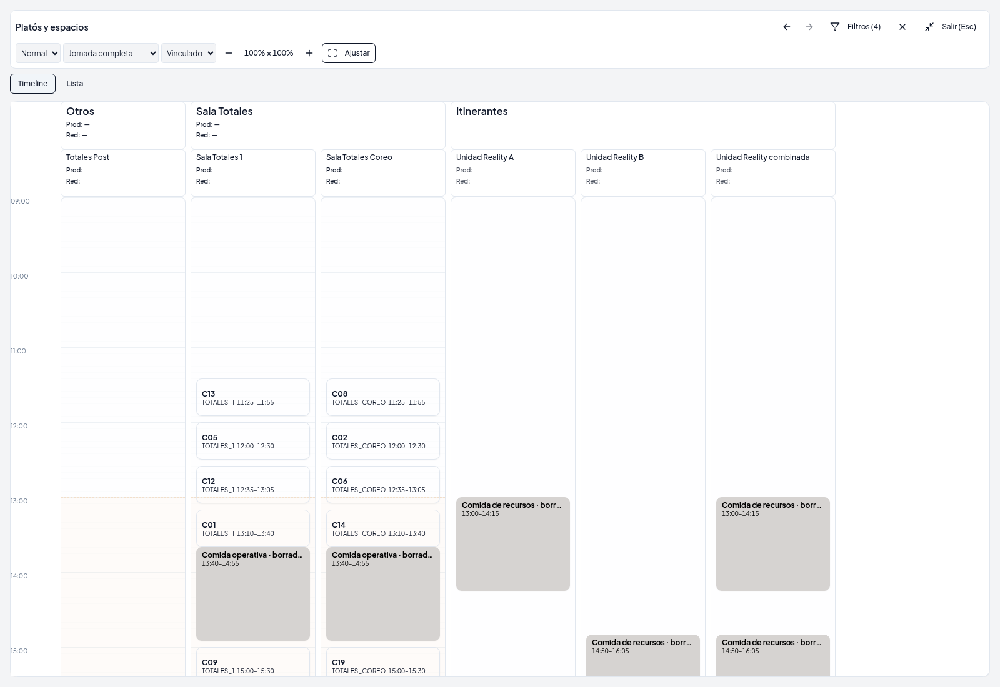
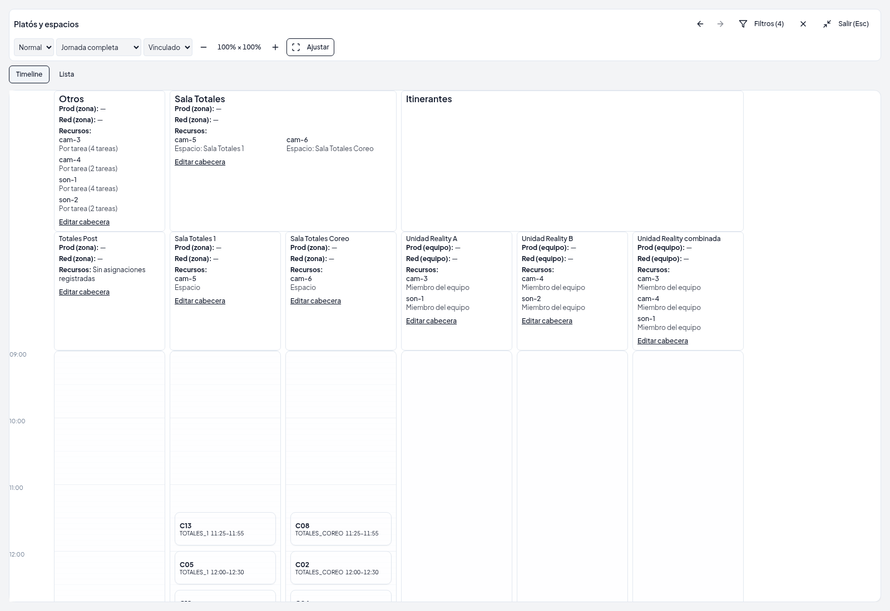
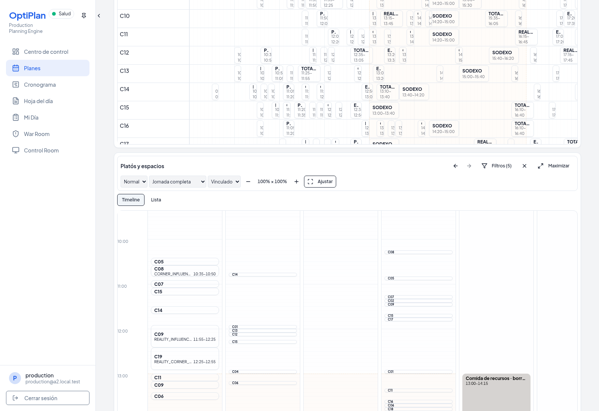
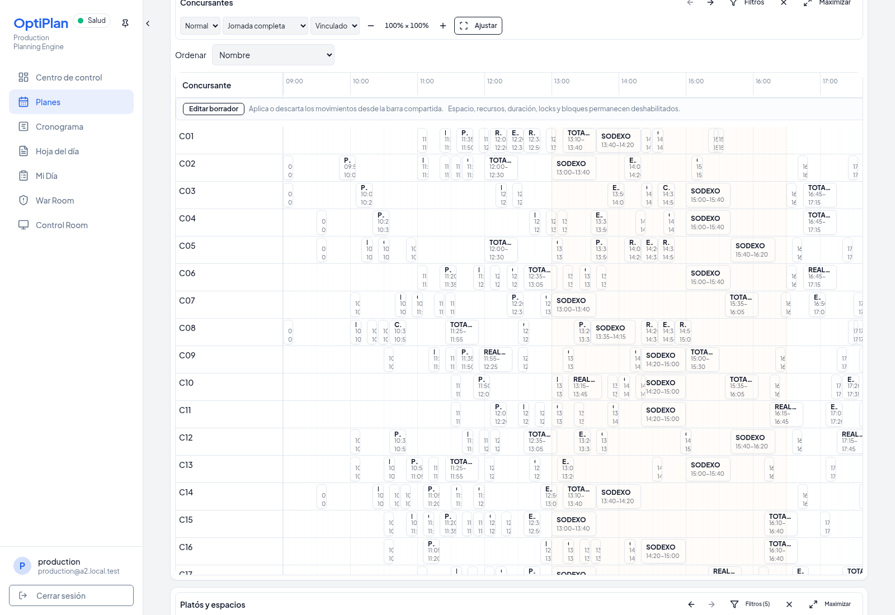
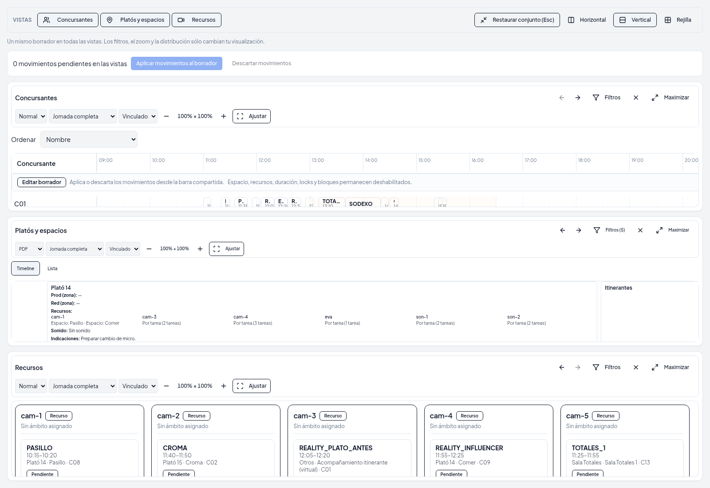

# UI-06 — Cabeceras operativas e indicaciones de jornada

Base: `4f7f3cb4afe8e58ad5d81faa1e99c79d4bfc0a04` (UI-05). Rama: `codex/ui-planning-headers-assignments-notes`.

## Datos y ámbitos

`planning-header.ts` es una proyección pura común para Timeline, Lista y cabeceras itinerantes de la agenda de recursos. Reutiliza las asignaciones explícitas de `plan_resource_items`, zona y espacio, los recursos directos de las tareas del snapshot presentado y `effectivePlanningResourceIds`. Una identidad aparece una vez, con todos sus ámbitos: **Zona**, **Espacio**, **Por tarea** y **Miembro del equipo**. Los recursos por tarea conservan sus identidades y número de tareas; no se presentan como destinados permanentemente al espacio. La zona resume además sus espacios, indicando sus nombres.

Producción/Redacción usan las identidades reales de `plan_staff_assignments` y el modo de `plan_zone_staff_mode`. Con modo espacio, el plató resume cada persona una sola vez junto a sus espacios, sin reactivar asignaciones antiguas de zona. No se crean personas, recursos ni asignaciones a partir de los PDFs, nombres o catálogo. Los miembros técnicos de un itinerante proceden exclusivamente de `plannerNextConfiguration.itinerantTeamAvailability.planResourceItemIds`. La participación de un equipo en un espacio sólo se indica si la tarea lo declara explícitamente; compartir algún recurso no implica pertenencia al equipo.

Los dos PDFs oficiales A2 se consultaron como referencia de presentación: ubicación, cámara, personal e instrucciones (sin sonido, cambio de micro, tablet). No se copió ninguno de sus nombres o textos al día. El replay conserva los nombres concretos de los recursos del fixture (`cam-1`, etc.), vinculados a sus identidades reales. Las capturas comparan la misma base SQL y los mismos filtros; `Ocultar vacíos` elimina del encuadre el catálogo histórico ajeno al día.

Las cargas de recursos y personal distinguen pendiente, error y vacío real. Una lectura fallida nunca se traduce en “Sin asignaciones registradas”. El editor de ubicación sólo se ofrece para IDs presentes en los snapshots diarios, leídos con las APIs existentes de disponibilidad, sin inicializarlos ni modificarlos.

## Indicaciones y permisos

No existía una entidad adecuada: comentarios de tareas, incidencias y configuración efectiva tienen otros contratos. La migración `095_planning_header_notes.sql` añade una tabla independiente con clave `(plan_id, scope_type, scope_id)`, array ordenado `lines`, versión, autor y fecha. Los ámbitos admitidos son zona, espacio y equipo itinerante con pertenencia explícita al día. La posición de cada elemento es su orden de presentación. Guardar sustituye un único ámbito de forma atómica; borrar todas las líneas deja el documento vacío con su nueva versión para evitar conflictos ABA.

Límites compartidos: 20 líneas, etiqueta opcional de 80 caracteres, texto de 4000, 16000 caracteres en total. API y SQL validan; React presenta texto plano con saltos de línea. No se interpreta HTML. El editor permite añadir, editar, subir/bajar y eliminar; conserva el borrador ante error. La versión observada se captura al abrir: un guardado concurrente devuelve 409, sin sobrescribir al otro usuario.

Admin y Producción editan por la API autenticada. Admin, Producción, Aux y Viewer consultan conforme a la política existente de jornadas. RLS permite lectura a esos roles; no concede escrituras directas a `authenticated`. La RPC de escritura es `SECURITY INVOKER`, accesible sólo por `service_role`, y vuelve a comprobar el rol del actor. Ni un usuario sin rol ni uno anónimo obtienen las notas. El ámbito se valida contra la jornada antes de escribir.

El cache compartido se actualiza y consulta después de guardar. Otras sesiones consultan cada 15 segundos y al recuperar foco. Este mecanismo no requiere publicar la tabla en Realtime. Ninguna de estas operaciones invalida consultas de Assisted, configuración ni Stages.

## Geometría

Un `ResizeObserver` mide el contenido natural de cada cabecera. Todas las columnas reservan el máximo de zona y espacio; el eje horario y la geometría de Ajustar usan esos mismos valores. Los nombres y notas se ajustan al ancho sin elipsis. Los colores mantienen el resolver existente de plató/espacio. Las columnas conservan scroll bidimensional y un mínimo legible de 140 px; Ajustar puede conservar desplazamiento horizontal si hay demasiadas columnas para ese mínimo. El texto mantiene su tamaño mientras zoom X/Y cambian las dimensiones operativas.

Cuando las cabeceras ocupan gran parte del viewport pasan al flujo normal para poder desplazarlas completamente y alcanzar las tareas. Las cabeceras cortas mantienen el comportamiento sticky. No se transforma ni escala el grid.

## Reproducción

```sh
npm ci
npm run check
npm run check:migrations
npm run build
node --import tsx --test client/src/lib/planning-header.test.ts server/planningHeaderNotes.spec.ts server/planningHeaderNotesSql.spec.ts client/src/lib/planning-view-policy.test.ts client/src/lib/planning-operational-meals.test.ts client/src/lib/planning-workspace-geometry.test.ts

git worktree add --detach /ruta/base-ui06 4f7f3cb4afe8e58ad5d81faa1e99c79d4bfc0a04
mkdir /ruta/base-ui06/node_modules
for dependency in "$PWD"/node_modules/* "$PWD"/node_modules/.bin; do
  ln -s "$dependency" "/ruta/base-ui06/node_modules/$(basename "$dependency")"
done
npx --no-install playwright install chromium
UI06_BASELINE_ROOT=/ruta/base-ui06 node --import tsx script/demo/smokeA2Integration.ts work/ui06-integration --historical-topology --header-notes
```

El harness reutiliza el replay S22 introducido por UI-05, aplica el ledger completo a PostgreSQL descartable y utiliza GoTrue, PostgREST y Chromium reales. Las credenciales locales se generan en memoria. No se interceptan respuestas, no se sustituyen RPCs y no se escribe en el proyecto Supabase conectado. La base comparativa y el candidato consultan el mismo SQL local. Para este ensayo se completan únicamente en la base descartable las tres identidades de equipos remapeadas que faltaban en el replay, reutilizando IDs y etiquetas del fixture canónico y sus miembros ya configurados. No se altera el fixture S22 ni se inventa personal o asignaciones. El resultado no certifica una nueva generación del solver.

## Validación y resultados

**PASS:** `npm run check`, `npm run build`, `npm run check:migrations`, **41 pruebas focales sin fallos**, ledger nativo completo y recorrido Chromium. El replay contiene 11 recursos, 6 asignaciones explícitas de espacio, 72 tareas con recursos directos y 0 asignaciones de personal. **266/266 conservadas, 0 escrituras operativas desde la UI, 0 escrituras remotas.** Las filas y `xmin` coinciden en las quince tablas comprobadas. La huella antes/después es `6b3dd5335bf2690eb629327e41b17d0e9824567ec616886bd6015f6b54b6fd33`.

Resultados: `validation.json`, `header-notes.json`, `integration.json` y logs públicos adjuntos. Se verificaron texto plano de varias líneas, notas de espacio de casi 3000 caracteres y acceso a las tareas después de desplazar cabeceras más altas que el viewport; también borrador/aceptado, sincronización entre sesiones y conflicto concurrente 409. El workflow `Planning operational headers` reproduce los checks, pruebas focales y ensayo nativo y adjunta sólo Evidence pública; excluye logs privados y credenciales.

Para la preservación se comparan filas completas **y `xmin`** en quince tablas operativas antes y después de todas las pruebas, incluidos `plans`, `daily_tasks`, snapshots/Stages, sesiones, revisiones, locks, pausas y asignaciones. Las indicaciones son las únicas filas nuevas. El harness también verifica el día histórico de 266 tareas/11 Stages y las 333 tareas de otra jornada.

## Límites de entrega

Debe aplicarse la migración 095 antes de usar el editor en un despliegue. El ensayo utiliza una jornada A2 descartable con decisiones ya aceptadas, no el proyecto real. La sincronización entre sesiones tiene un intervalo máximo nominal de 15 segundos con las pestañas activas, además de refresco al foco. No se ejecuta Full A2 ni se modifica Engine, búsqueda, validación, comidas, tareas, horarios, locks o Stages. Sin merge ni publicación Replit.


## Capturas comparables








