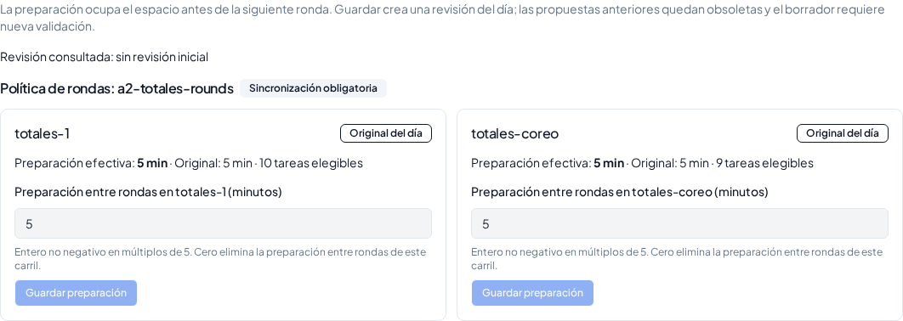
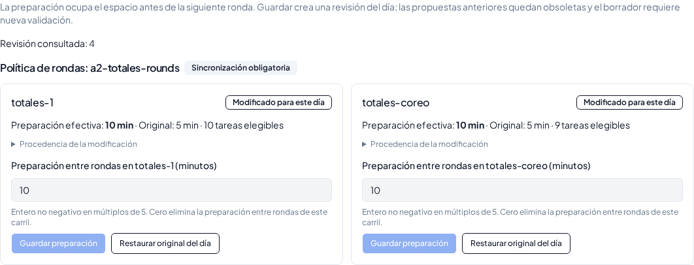

# U06a — Preparación diaria entre rondas

Base: `a6ab898a0d443be17e3ef4a33d09a5e1cdbe456a`, con #1168 y #1169 integrados. Rama de entrega: `codex/u06-round-preparation-day-editor`. [baseline.json](baseline.json) identifica la base y los hashes de las fronteras preservadas. No se modifican Fuentes oficiales, lógica del solver, presupuestos, timeouts de producto, transporte, cierre temprano ni presentación de estados de #1169.

## Causa y contrato aplicable

X: el motor representaba la preparación entre rondas, pero un usuario no podía cambiarla desde Day Setup. Y: `planner_next_configuration` era un snapshot protegido sin recorrido diario de edición para ese parámetro. Z: cualquier cambio exigía intervención técnica. W: añadir un override tipado por política/carril a la operación diaria versionada. M: leerlo al construir `EngineInput`, variar ocupaciones válidas y rechazar propuestas/validaciones antiguas.

Autoridad: Fuentes 00 v2.13; 01 v5.2 §12; 03 v3.7 (unidades REQUIRED y witness futuro); 04 v2.7 §§5, 8.2, 9 y 20; 05 v2.7; 06 v2.10 para el canon A2; 07 v2.2 §4.4. Se contrastaron el documento maestro de adecuación, P1/U06 y `PLANNER_CAPABILITY_CATALOG.md` SPA-06. La Fuente 04 ya autoriza snapshot diario → override autorizado → revisión/fingerprint/replay y distingue preparación de duración productiva. No falta una nueva decisión normativa para esta edición limitada.

## Autoridad efectiva y recorrido

```text
DayConfiguration / RoundPreparationEditor
 → PUT day-configuration o POST day-configuration/restore (auth admin/production)
 → esquemas estrictos DayConfig + revisión consultada + política/espacio existentes
 → dayConfigurationService: estado actual, candidato y preflight existente
 → apply_day_config_operation_v4: rol, lock de plan, revisión y candidato
 → round_preparation_overrides + operación v3/v2/v1 + plan_config_revisions
 → EngineInput: snapshot 088 + override de minutos
 → adaptador y exactRoundSynchronization existentes
 → validatePlan / validateRoundSynchronizations existentes
 → propuesta, Draft, validación y Stage con configRevisionId
```

El original sigue siendo `plans.planner_next_configuration`: el trigger 088 permanece intacto. La migración **102, preparada y ensayada sólo en bases descartables**, añade `plans.round_preparation_overrides`, vacío por defecto. Cada entrada identifica política/espacio, minutos, autor y fecha; no acepta miembros, carriles, severidad ni una política de reemplazo. Un trigger rechaza escrituras directas; la función es `SECURITY INVOKER`, restringida a `service_role`, y vuelve a comprobar admin/production en `user_roles`/`roles`.

La nueva función envuelve la cadena existente y contrasta el replay con la proyección efectiva de rondas, incluso al editar otras categorías. Se extiende únicamente el conjunto de RESTORE reconocidos del escritor existente; su cuerpo conserva el de 099 en lo demás. El lock/revisión, la materialización canónica de históricos y la invalidación de `draft_validation_id` son los existentes. Un error revierte override, revisión y sesión en la misma transacción.

`buildEngineInput` aplica sólo los minutos sobre las políticas originales. Sin override devuelve la misma representación histórica. La proyección existente de `plan_workday` ya incluye las políticas: nuevo valor → fingerprint/replay diferentes; restaurar recupera la semántica original con una revisión nueva. Propuestas de otra revisión no pueden aplicarse y un Draft debe revalidarse. Los Stages conservan su configuración histórica.

## UI y alcance

Nueva sección «Preparación entre rondas» en la configuración del día: políticas existentes, espacio, tareas elegibles, minutos efectivos y originales, procedencia, autor/fecha y revisión consultada. Se guarda un carril por operación. RESTORE elimina el override y recupera el original local, sin consultar defaults actuales. Viewer sólo ve los valores; admin y producción pueden editar.

| Original del día | Override guardado y recargado |
|---|---|
|  |  |

El contrato permite cero explícito. El motor vigente exige la rejilla de 5 minutos: valores negativos, decimales, strings y desbordamientos se rechazan por contrato; enteros no representables, por preflight, sin redondear. No se crean políticas, no se alteran miembros/severidad y no hay refresh/general de esta familia. `SYNCHRONIZED_ROUNDS` sigue **PARTIAL** en el registro: U06a no certifica el editor completo de coordinación.

## Reproducción

```sh
npm ci
npm run check
npm run check:migrations
npm run build
node --import tsx server/roundPreparation.spec.ts
node --import tsx server/roundPreparationSql.spec.ts
node --import tsx engine/planner-next/planMainFlowAndFeeders.spec.ts
node --import tsx --test --test-concurrency=1 server/dayConfiguration.spec.ts server/effectiveConfigurationView.spec.ts server/transportConfigIntegrity.spec.ts script/demo/a2Preflight.spec.ts
node node_modules/typescript/bin/tsc -p script/demo/tsconfig.integration.json
node script/run-test-suite.mjs engine/planner-next
PLAYWRIGHT_BROWSERS_PATH=/tmp/u06-browsers node node_modules/playwright/cli.js install chromium
PLAYWRIGHT_BROWSERS_PATH=/tmp/u06-browsers node --import tsx script/demo/smokeA2Integration.ts /tmp/u06-native --full --manual-validation --transport-policy --round-preparation
```

El ensayo nativo usa PostgreSQL 17, GoTrue, PostgREST, el ledger completo del repositorio, HTTP del producto y Chromium. La importación inicial aporta las políticas existentes; **todas las variaciones de minutos se realizan por UI/API**, sin cambiar el fixture ni el JSON protegido. Solicita propuestas por el recomendador normal, con los límites de producto sin cambios. Comprueba edición 5→10 en ambos carriles, recarga, `EngineInput`/adaptador, witness completo independiente, aplicación y validación HTTP del Draft; después prueba cero, restore y preservación de material histórico. El retorno del ensayo a S0 usa la operación guardada `RESTART_BOOTSTRAP` existente; sólo afecta a la jornada local propiedad del ensayo. El recorrido canónico posterior usa 5 y conserva sus assertions originales de 266/266 y once Stages.

La prueba genérica focal usa una política distinta de dos carriles: 5, 10 y 0 cambian las ocupaciones manteniendo HARD válido. Repite 10 para comprobar fingerprint y ocupaciones deterministas, verifica input inmutable y demuestra que validar ocupaciones antiguas contra 10 produce violación de preparación. El ensayo SQL focal ejecuta las funciones reales 092/099/102 y comprueba roles, referencias, cero, concurrencia, restore y fallo anidado sin escritura parcial.

El [informe U06a nativo](round-preparation.json) registra el efecto real: dos carriles y **17 preparaciones de 10 minutos, 170 minutos de ocupación derivada**, con cero violaciones en la validación independiente del witness. El mismo original de 5 requiere 85 minutos para esas 17 preparaciones. La duración productiva no se incrementa; cambia la ocupación entre rondas. El nuevo Draft se aplica y valida por HTTP; no se acepta un Stage con 10 en este ensayo. La aceptación de Stages se verifica después con los parámetros canónicos restaurados. Esto separa la sensibilidad de configuración de la compatibilidad canónica.

## Límites y resultados anteriores a la entrega

El [informe de validación](validation.json) y la [integración nativa](integration.json) registran los resultados del candidato:

| Gate | Resultado |
|---|---|
| TypeScript de producto y del harness, build y secuencia de migraciones | PASS |
| Contrato/proyección/determinismo genéricos nuevos | 4/4 PASS |
| Test PostgreSQL nuevo de roles, referencias, concurrencia, fallo anidado y restore | PASS |
| Configuración/preflight | 6 archivos PASS |
| Autorización, revisión y servicios Assisted | 58/58 PASS |
| Suite completa Planner Next | **1269/1269 PASS**, sin skips |
| PostgreSQL/Auth/PostgREST/HTTP/Chromium | **29 checks PASS**, `remoteWrites=0` |
| Canon A2 restaurado | **266/266**, **11 Stages**, validación independiente, comidas/preparaciones y viewer/rollback/redo |
| JSON protegido 088, solver/validador y archivos de presentación de #1169 | Hashes intactos |

El perfil nativo también pasa las integraciones existentes de validación manual y transporte: [informe manual](manual-validation-probe.json) e [informe de transporte](transport-policy.json). No se alteraron sus parámetros canónicos para obtener verde. Las mediciones bajo carga concurrente no se usan como comparación de rendimiento.

Los logs privados y credenciales del ensayo no se entregan. Ninguna prueba local acredita Supabase conectado, RLS live del proyecto remoto o Replit publicado. No se aplica ninguna migración ni publicación remota.

Se encontraron dos fallos **preexistentes** en `shared/configurability.test.ts`: cifras antiguas de `PRODUCT-CONFIGURABILITY-AUDIT-v2.4.md` y una expectativa de `FIXED_COUNT(n)` anterior a SOFT. Se reprodujeron con ambos archivos y la Evidence extraídos de la base exacta; U06a no cambia esos estados ni esas semánticas. Se conservan identificados en la entrega.

La suite amplia también hizo visible la lista explícita de fronteras autorizadas de Next. Se añaden sólo el servicio diario que consume preflight, la vista que consume la rejilla y el test de proyección. La configuración no despacha búsquedas. La implementación del motor y sus validadores no cambia.

Intentos de preparación: se completaron las dependencias del lockfile, sin cambios de manifests. La CLI Supabase disponible no pudo preparar un archivo por su escritura en un home de sólo lectura; se usa la numeración 102 exigida por el validador del repositorio, con SQL ejecutado en los ensayos locales. El primer `npm run build` encontró la restricción de IPC de tsx; `node --import tsx script/build.ts` ejecuta el mismo build sin ese IPC. Los intentos nativos previos descubrieron problemas del sondeo HTTP del ensayo, el uso del ID de producto frente al ID canónico del adaptador y el alcance limitado del reset manual; no se presentan como gates aprobados ni se cambió lógica productiva para resolverlos.

Una ejecución `--full --round-preparation` cerró U06a, 266/266, once Stages, viewer y rollback/redo, pero su extensión adicional `smokeA2ViewsHistoryJourney` terminó esperando el botón «Orden por tarea». Ese resultado global es FAIL y no se presenta como PASS. El gate de configuración de esta entrega usa el perfil existente de CI `--manual-validation --transport-policy`, que ejecuta validación manual y configuración en vez de esa extensión de vistas. No se altera el planning ni la lógica de #1169 para resolver el ensayo visual ajeno al delta.

Trabajo posterior: catálogo general, creación/edición de políticas, miembros/carriles y otras familias U06; certificación/despliegue por el procedimiento operativo autorizado. Sin merge ni despliegue en esta unidad.
