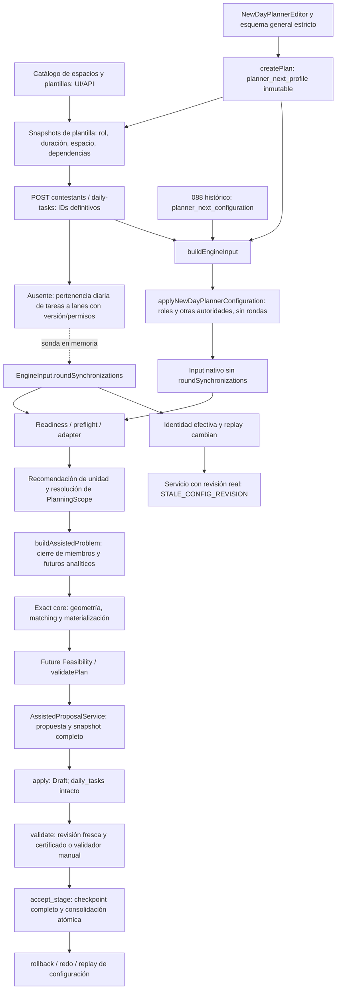

# Recorrido causal y consumidores en la base autorizada

Las flechas de la sonda no representan un camino disponible en producto. No se persiste su nueva revisión. El recorrido nativo llega al Stage sin ninguna autoridad de sincronización; no es evidencia de un Stage sincronizado.

| Frontera | Autoridad y consumidor exactos | Resultado observado / límite |
| --- | --- | --- |
| Catálogo | `shared/newDayPlannerConfiguration.ts::templatePlannerOperationSchema`; editor de rol; APIs de plantillas/espacios | Roles auxiliary explícitos, IDs de catálogo; no inferencia por nombre |
| Perfil general | `newDayPlannerConfigurationSchema`; `client/src/components/new-day-planner-editor.tsx`; `server/newDayPlannerConfigurationRoutes.ts` | ADMIN, CAS de revisión. Schema strict sin campo de rondas; PUT extendido da 400 |
| Alta del día | `server/storage.ts::createPlan`; snapshots de plantillas/optimizer/espacios; 105/106 | Congela perfil/revisión general y composición vacía. No existen todavía IDs diarios de miembros |
| Alta de instancias | `createContestantForPlan` / `createDailyTask`, rutas de producto | Se obtienen IDs diarios reales; tareas mediante API después del alta en UI |
| Primera ausencia | Entre estos IDs y la configuración efectiva diaria | No hay editor/writer/snapshot de pertenencia a carriles para perfiles nuevos. `technicalChains` comparte ausencia de productor; no se desarrolla aquí |
| Builder | `engine/buildInput.ts`: `applyNewDayPlannerConfiguration` → `applyPlanPlannerNextConfiguration` → composición diaria → preferencias/preparaciones/continuidad | El primer materializador genera operaciones/dependencias/setups pero no rondas. El segundo sí entiende rondas por IDs, sólo en contrato histórico |
| Exclusión de autoridades | SQL 088/105/106; builder de composición diaria | Histórico inmutable, profile inmutable, single-authority CHECK; no se puede adoptar 088 como editor de un día nuevo |
| Editor de preparación | `server/roundPreparation.ts::baselineLane`, `roundPreparationValues`, `candidateRoundPreparations`; editor existente | Sólo minutos sobre una lane de 088 ya existente. Nuevos días muestran lanes vacías; no crea policy ni miembros |
| Readiness/preflight | `server/effectiveConfigurationView.ts` → `plannerReadiness`; `engineInputPreflight.ts` → `engineInputRoundSynchronizations.ts::resolveEngineInputRoundSynchronizations` | Ausencia de rondas no es error. Con declaración inválida: UNSUPPORTED y detalles de identidad, rol, espacio/duración |
| Adaptación | `engineInputAdapter.ts::adaptEngineInputToPlannerNextProblem` | Identidades `task:`, `space:`, `round-synchronization:`; política preservada/fingerprint. Preflight canónico equivalente en `roundSynchronization.ts` |
| Recomendación | `server/assistedScopeOrchestrator.ts::recommendNextAssistedScope` | Agrupa cuatro tareas en ROUND_SYNCHRONIZATION; prioridad estructural y ventanas, no iteración de salas por ID |
| Resolución | `server/assistedScopeResolver.ts::resolveAssistedScope` / `expandVisiblePrerequisites` | IDs de producto → canónicos; semántica de selección intacta |
| Scope / futuro | `assistedPlanning.ts::buildAssistedProblem`, cierre iterativo de miembros, `analyticalFutureRoundSynchronizations` | Single/SPACE incluye todos los peers para búsqueda. Independiente conserva la ronda completa en contexto analítico al usar el eligibility del servicio |
| Decisión estructural | `exactItinerantPlan.ts`: unidad ROUND_SYNCHRONIZATION → `probeExactRoundSynchronizationMacroDomain` → `exploreExactRoundSynchronizationPolicy` | Unidad multi-espacio y ledger compartido. No cambia budgets ni heurísticas |
| Geometría | `exactRoundSynchronization.ts::buildSlots` / `preparationAvoidsExistingOccupations` | Slots por ronda/duración común, preparación física, disponibilidad de cada sala y ocupaciones previas. Las ventanas no se sustituyen por la unión de salas |
| Matching | `materializeMatchingCandidate` → `findCanonicalPerfectMatching` → `canPlaceTask` | La arista exige pertenencia a lane y placement válido. Materializa identidades sobre slots; el orden de IDs de la lista no fija el orden temporal |
| Future Feasibility | `exactItinerantPlan.ts` futuro colectivo → explorador, prerrequisitos, participantes/comidas → `validateRoundSynchronizations` | El independiente conserva witness de dos lanes, matching/preparaciones. No se convierte en tareas aceptadas. Revalidación disponible en `revalidateFutureRoundSynchronizationWitness` |
| Validación | `validate.ts::validatePlan` → `validateRoundSynchronizations` | Inicio y fin ordinales comunes mientras ambas lanes activas; preparación exacta, disponibilidad y sin solapes. Omisión/desplazamiento fallan HARD, sin degradar a preferencia |
| Identidad/replay | `effectivePlanConfigRevision.ts::projectEffectiveAuthoritiesFromEngineInputV1`, `buildEffectivePlanConfigRevisionV1`; `assistedPlanningConfigRevision.ts` | `plan_workday[0].plannerNextAuthorities.roundSynchronizations` participa en identidad/replay. Hash cambia en la sonda; no basta conservar el antiguo |
| Propuesta | `AssistedProposalService.request/run` | Revisión real se contrasta antes de adaptación/búsqueda en run. Resultado simulado mediante seams existentes; snapshot incluye todas las obligaciones y preparaciones usando IDs fuente |
| Draft | `buildAssistedPlanningSnapshotV1`, fingerprint; `assisted_apply_proposal` | Propuesta aplicada al Draft, snapshot completo; no modifica `daily_tasks`. Proyección simulada no aplicada |
| Validación Assisted | `AssistedPlanningService.validate`, `assisted_record_proposal_clean_validation` (113), o materialización manual canónica | Revisión actual, base, source origin, resultado íntegro y snapshot/certificado; falta de autoridad no se repara mediante snapshot de planning |
| Stage | `AssistedPlanningService.accept`, `assisted_accept_stage` (113 y guards retenidos) | Permisos, CAS/base/revisión/freshness, validación/confirmación y snapshot completo. Conserva provenance, escribe `daily_tasks` atómicamente. Sólo recorrido ordinario ejecutado hasta aceptación |
| Replay | `buildEffectivePlanConfigReplaySnapshotV1`, SQL restore/move de 113; replay frío de esta Evidence | Configuración vigente separada de Stage histórico. Restore del ordinario es real. Snapshot sincronizado sólo simulado/cold-replayed |

## Qué protege SQL y qué falta

088 impide editar el JSON histórico; 105 impide modificar el profile o mezclar ambos; 102 protege los overrides de minutos y verifica los replays esperado/candidato contra la política histórica; 104 conserva esa comprobación a través de v5. 107 captura fuentes (incluida fila completa de plans) y 113 conserva origen de obligaciones y freshness. El certificado de validación de 113 liga resultado íntegro, scope, snapshot/fingerprint, base y revisión. Son controles reales, no una operación estructural de escritura.

No se ha demostrado un validador SQL independiente de geometría de rondas: esa semántica la valida el servidor/motor y SQL vincula el certificado a las autoridades/revisiones. No se debe afirmar que el hash por sí solo prueba sincronización. Incorporar una nueva autoridad exige comparar su valor efectivo también en el writer SQL y cerrar su vínculo con bootstrap/config refresh/origen vigente; sin ello existe el rechazo reproducido o una inconsistencia de autoridad.

## Perspectiva de producción

Se pueden crear todas las actividades y sus ventanas, pero no declarar la pertenencia que las coordina. Los nombres de salas/tareas no son reglas. Una solución ordinaria completa puede incumplir la coordinación humana no guardada. Con política explícita representable, el consumidor respeta espacios y preparaciones, y con ventanas incompatibles no ofrece propuesta. Mezcla de duraciones no cabe en el contrato actual; debe explicarse antes de guardar/solicitar. El siguiente editor debe mostrar límites y miembros efectivos y usar la unidad completa en Assisted, conservando siempre la tarea independiente fuera de esa unidad.
