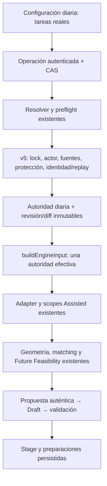

# Autoridad diaria de rondas sincronizadas

Base: `2d95be9fd74fdf60433b1b71ad3704522d558eb4` (U00o, #1193). Se mantiene su diagnóstico. Fuentes 00 v2.15, 01 v5.4, 03 v3.8, 04 v2.9, 05 v2.8 y 07 v2.3; sin cambios normativos.

## Contrato y propietario

`plans.daily_round_synchronization` es la única autoridad efectiva nueva. El perfil congelado y 088 permanecen inmutables. No se añaden tabla, servicio ni endpoint de escritura. Se extiende `PUT /api/plans/:id/day-configuration` con una operación exclusiva `roundSynchronization` + `expectedRevisionId`.

```ts
{
  contractVersion: 1,
  policies: [{
    id: string, // identidad estable, creada una vez; se conserva al modificar
    synchronization: "START_TOGETHER_WHILE_ALL_LANES_ACTIVE",
    lanes: [
      {spaceId: number, taskIds: number[], preparationMinutesBetweenRounds: number},
      {spaceId: number, taskIds: number[], preparationMinutesBetweenRounds: number}
    ]
  }],
  by: string, at: string // sólo el escritor SQL los produce
}
```

Máximo una política y exactamente dos carriles, al menos dos tareas por carril. La duración procede de las instancias y sus snapshots diarios; no existe una segunda duración editable. Se exige uniformidad y rejilla de cinco. El orden de selección es pertenencia, no precedencia temporal: el matching existente decide el orden. REQUIRED es la semántica fija del contrato; no hay degradación a PREFERRED. `null` inicial y `policies: []` explícito representan ausencia; retirar crea revisión y conserva su provenance.

La UI selecciona por operación, participante y espacio. Sólo presenta como efectiva una autoridad releída. Distingue ausencia, configuración efectiva, incompatibilidad y protección/Draft. Las tareas independientes no entran en ninguna lane por compartir espacio, plantilla o nombre.

## Recorrido único



La migración **114** conserva literalmente la rama legacy 088 + overrides de 102. Para la autoridad nativa, v4 contrasta el replay con el valor diario realmente persistido. v5 reutiliza permisos ADMIN/PRODUCTION, CAS, revisión y escritor v3 existentes. SQL valida referencias del mismo día/espacio, unicidad, participante, rol/duración, preparación, locks y ejecución. Bloquea propuestas pendientes y Draft sucio. El resultado y sus ocupaciones se siguen produciendo mediante Assisted, sin tocar `executePlannerNext` ni algoritmos/budgets.

La identidad conserva el serializador canónico existente. El guard comprueba que el candidato difiere del replay esperado exclusivamente en rondas, recalcula el componente workday y el fingerprint compuesto, y vincula la revisión a sus padres. No recibe un EngineInput libre del navegador. Los certificados nativos también comprueban materialmente rondas/preparaciones contra autoridad y revisión: recalcular hashes no autoriza omitir preparaciones o mover un carril.

Los helpers nuevos son invoker, con `search_path=''`, EXECUTE privado a service_role; el endpoint productivo sigue siendo el existente y autenticado. La columna hereda RLS de plans y tiene trigger contra escrituras directas. No se amplían grants de tablas.

## Sesión, origen e históricos

Una edición estructural no admite tareas. Se conserva sesión, WorkingOrigin, Draft y cada Stage. La revisión existente almacena en su diff una transición explícita: revisión anterior de plan **y** sesión, Stage base, autoridad anterior/nueva y captura completa de fuentes. Así se reutilizan 107/113 sin otra tabla ni reescribir bootstrap/admisiones. El comparador utiliza la captura más reciente entre transición de configuración y admisión U00n.

Se permite configurar tras S0 con Draft limpio. Tras un Stage sólo puede cambiar una política que no afecte a decisiones protegidas; una política que toca placements aceptados debe permanecer literal. Se demuestra el caso compatible: independiente aceptada, rondas pendientes, cambio de 5 a 10 minutos, aceptación posterior sin mover la independiente. Se rechaza cambiar/retirar rondas ya aceptadas.

Rollback/redo restaura decisiones y fingerprints históricos y conserva la configuración vigente. La admisión posterior U00n añade otra independiente en la misma sesión; también sobrevive al rollback a S0 y al redo de la rama.

Dos precisiones conservadoras evitan cambios retroactivos:

- Una autoridad nueva `null` se omite de la captura de sources de plans, conservando literalmente los tokens previos al añadir la columna.
- Sólo para comparar el origen S0 se normaliza la equivalencia ya documentada de asignación vacía `null`/`[]`; cada otro campo y fila se compara exactamente. No se modifica la captura histórica. El preview de altas anterior a S1 compara su captura literal, incluso tras una transición estructural; no sustituye datos pendientes por una proyección de decisiones.

## Límites

Sólo STANDALONE_ONLY, transporte NONE, setup NONE, dos carriles físicos con auxiliares con participante, duración uniforme y preparación múltiplo de cinco. Se rechazan IDs ausentes/duplicados/de otro día, espacios equivocados y roles no representables. Cadenas, joint groups, setups, continuidad estructural, equipos itinerantes, operaciones ancladas y comidas operativas estructurales requieren otro gate y no se activan aquí. No hay catálogo de estructuras, duraciones mixtas, sincronías adicionales, solver nuevo ni publicación.

La validación SQL añadida es un guard del certificado de rondas, no un segundo planificador ni una prueba genérica de toda geometría. La factibilidad y sus witnesses siguen perteneciendo al motor/validador existentes y a los recibos de producto.
