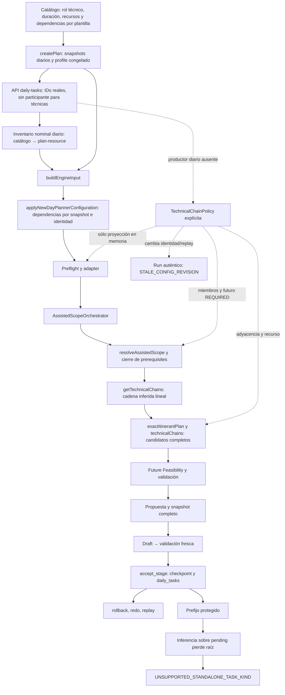

# Diagrama causal real y respuestas

La flecha punteada no representa una capacidad productiva. El código histórico 088 sabe consumir una cadena explícita ya materializada, pero no es un editor aplicable al profile nuevo. No se declara C: la cadena nunca estuvo guardada en la autoridad nativa.

| Paso | Función/archivo vigente y efecto |
| --- | --- |
| Catálogo / dependencias | `server/storage.ts::createTaskTemplate` y snapshots; `taskTemplateSnapshot.ts`: persisten `dependencyTemplateIds`, rol y `resourceRequirements` |
| Alta | `storage.createPlan` congela `planner_next_profile`, snapshots y recursos; `createDailyTask` crea las identidades definitivas |
| Materialización | `engine/buildInput.ts` y `server/newDayPlannerConfiguration.ts::applyNewDayPlannerConfiguration`: cada dependencia de plantilla se resuelve contra instancias activas del mismo `contestantId`, incluido null para estas técnicas |
| Recursos | materialización por catálogo/día y proyección de requisitos conservan `plan-resource:<id>`, exclusividad y ventanas. Se verifica byItem, no un pool intercambiable |
| Preflight/adapter | `integration/engineInputPreflight.ts` valida roles/referencias y shape de políticas; `engineInputAdapter.ts` conserva dependencia, duración, espacio y recurso; policy explícita recibe namespace `technical-chain:` |
| Recomendación | `server/assistedScopeOrchestrator.ts::recommendNextAssistedScope`: attach TECHNICAL_CHAIN sólo para política explícita (o feeders de un main configurado). Sin ella, estos días usan SPACE_FALLBACK |
| Scope | `assistedScopeResolver.ts`, `assistedPlanning.ts::buildAssistedProblem`: dependencies transitivas; con policy, cierre de todos los miembros y reserva analítica de cadenas futuras elegibles |
| Unidad inferida | `technicalChains.ts::getTechnicalChains`: técnicas conectadas linealmente desde raíz sin dependencies; no crea TechnicalChainPolicy |
| Dominio/candidatos | `exactItinerantPlan.ts` construye macro TECHNICAL_CHAIN; `createTechnicalChainExplorer`: earliest de cada sucesora es fin previo, admite huecos. Policy REQUIRED utiliza `createContiguousTechnicalChainExplorer`: cursor exacto y recurso requerido en cada miembro |
| Futuro | `PreparedFutureTechnicalChainAuthority`: witness completo, reutilización/reparación, cero dominio certificado o ABSTAIN. La reserva no entra en propuesta visible |
| Validación | `validate.ts::validatePlan`, `technicalOperations.ts::technicalIdentityMatches`: identidad/duración/recursos/dependencies; además orden de cadena, adyacencia/recurso si policy explícita |
| Persistencia | `AssistedProposalService`, snapshots/fingerprints, `AssistedPlanningService`, RPC 077/110/113/114: run → Draft → validación → Stage. La configuración efectiva tiene identidad separada |
| Corte protegido | `exactItinerantPlan.ts::unsupportedShapeReasons` deriva cadenas de `pending`; T3 dependiente de T2 ya protegido no tiene raíz pendiente. No es geometría ni budget |

## Nueve respuestas

1. **STANDALONE_ONLY:** requiere EXACT_CONSTRUCTIVE, ausencia de mainFlow y roles auxiliary/technical explícitos. Auxiliary requiere participante; técnica no admite participante/coach/blockKey/setup/joint según su contrato. No significa soporte universal de todo conjunto de esos roles: una técnica aislada sin unidad física itinerante ni cadena pasa adapter, pero este exact standalone devuelve UNSUPPORTED. Recursos alternativos de ordinary auxiliares y equipos itinerantes tienen contratos propios; no se convierten automáticamente en recursos intercambiables de cadena. Rondas diarias U00p tienen límites propios. Ver [contratos](contracts.md).
2. **Automático desde dependencias:** A/B forman T1→T2→T3 sin `technicalChains`, con orden y requisitos físicos. El extractor necesita raíz, conectividad lineal y técnicas representables; branching/ciclos no se aceptan como secuencia arbitraria. Múltiples instancias null de una plantilla previa pueden crear branching: no se deduce cuál quería producción.
3. **Agrupación en Assisted:** el recomendador no eleva estas dependencias a una unidad TECHNICAL_CHAIN; recomienda un espacio individual. El motor sí agrupa la cadena que está completa dentro del scope construido. Seleccionar el último miembro trae los prerequisites como supporting/visibles según resolver y request; seleccionar la raíz no trae sucesores inferidos. Con policy explícita, recomendación y cierre abarcan los tres miembros. El scope humano visible y los supporting deben seguir distinguiéndose.
4. **Orden frente a adyacencia:** dependency implica `predecessor.end <= successor.start`. Sólo policy `adjacency: REQUIRED` exige igualdad. A sin huecos es coincidencia de solución, no una autoridad REQUIRED. B prueba la diferencia física.
5. **Recurso nominal:** byItem diario fija identidad y el validador rechaza sustitución; `canPlaceTask` aplica disponibilidad, exclusividad y transición. La policy añade la obligación de que cada miembro consuma cada `requiredResourceId`, junto con adyacencia. No crea un hold independiente durante huecos de una cadena inferida ni autoriza elegir otro equipo del mismo tipo. No se prueba continuidad de “algún recurso equivalente”.
6. **Qué se elimina al fallar:** aquí no existe un matching nominal libre: las tres asignaciones byItem están fijadas. Un miembro sin el recurso REQUIRED elimina el **candidato de cadena completo**, no el miembro ni la obligación (cero candidatos). Un independiente que destruye el futuro se poda por su ID y su placement certificado; no se culpa a T1 arbitrariamente. Los caminos de matching de rondas/core tienen certificados y rematching específicos, descritos en [matching-future](matching-future.md), no ejecutados ficticiamente en estos días.
7. **Reserva futura:** sí, con policy explícita y `analyticalFutureEligibleTaskIds` auténtico. A reserva las tres técnicas, propone sólo la independiente y la desplaza a 09:45. Se captura reserva exacta con sus tres identidades y se revalida; nunca se escribe al Draft. Sin policy no se declara esa obligación futura estructural REQUIRED.
8. **Ausencia material:** A tiene mismos placements de cadena con o sin policy, pero identidad/futuro/scope distintos. B pasa de propuesta válida con huecos a cero dominio. El independiente de A pasa de 09:00 sin policy a 09:45 con ella. No es sólo presentación.
9. **Frontera de Stage:** no hay campo productor general/diario, ni escritor de dicha autoridad. API 400, histórico 088 inmutable, run genuino STALE_CONFIG_REVISION. El writer SQL genérico acepta replay diagnóstico sin materializar la autoridad y se revierte; no debe describirse como un guard material de cadenas. Faltan configuración efectiva y vínculo de revisión/certificado, no basta guardar un JSON o conservar hash antiguo.

## Producción y arquitectura

Como producción, las secuencias completas ya sirven cuando se toleran esperas y el equipo está declarado en cada tarea; no hace falta editor para usar eso. Hay que seleccionar el conjunto técnico completo para evitar el corte residual demostrado. No se puede prometer “sin interrupción” porque un ejemplo salga compacto. Un día con ventanas incompatibles con adyacencia debe explicar por qué no puede ofrecer propuesta.

Como arquitectura, el consumidor de policy no necesita ser reconstruido: preflight, adapter, cierre, geometría, futuro, validador e identidad ya la conservan. El primer hueco para B está antes de EngineInput. El caso D está después, en reconocer sólo el grafo pending sin conservar identidad de cadena inferida a través del Stage. El prefijo real falla a cero ramas, aunque conservar el prefijo y resolver la cadena explícita factible en memoria demuestra que la geometría existe. No modificar búsqueda/budgets para arreglar una clasificación de unidad ni presentar la ausencia de policy como pérdida del adapter.
